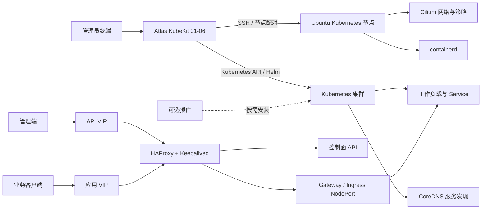

# Atlas KubeKit 产品概览与架构

阅读位置：`00` · 面向计划部署、运维 Kubernetes 集群的管理员 · [返回文档导航](00-文档导航.md)。

Atlas KubeKit 是一套以 Bash 为入口、Python 标准库辅助的 Kubernetes 部署与运维工具。它把主机准备、集群部署、常用插件、检查、负载均衡和持续运维组织为可交互的流程，帮助管理员减少手工拼接命令和重复维护配置。

## 用户能得到什么

- **一条连贯的部署路径**：从 Ubuntu 主机准备和身份检查，到控制面、工作节点、网络和可选组件，按角色逐步完成。
- **减少重复操作和配置漂移**：共用节点清单、集群配置、组件版本目录和脚本管理的服务配置；重跑前检查已有状态。
- **变更过程可理解**：复杂运维操作先检查当前事实、生成计划并说明影响，再由管理员确认执行；失败和中断保留可继续处理的状态。
- **按需扩展组件**：通过插件菜单安装监控、日志、存储、Gateway、策略等常见 Kubernetes 组件，不要求一次性安装全部插件。
- **适应受限网络环境**：可准备锁定的包、镜像、Chart 和工具物料，在节点无外网转发的环境中完成部署。
- **避免夸大保护能力**：控制面备份、卷保护登记和恢复计划分别说明覆盖范围，不把它们说成应用数据恢复或异地灾备。

## 组件构成

| 层次 | 主要组件 | 用途 |
| --- | --- | --- |
| 管理入口 | 01～06 号 Shell 脚本、共享语言目录和 Python 辅助模块 | 交互式准备、部署、插件管理、检查、LB 管理与持续运维 |
| Kubernetes 基础层 | Kubernetes、containerd、Cilium、CoreDNS、etcd | 容器编排、容器运行、集群网络、服务发现和集群状态存储 |
| 控制面访问 | HAProxy、Keepalived、Kubernetes API VIP | 为管理端和节点提供高可用 API 入口 |
| 应用入口 | 业务 VIP、HAProxy、Gateway 或 Ingress、Service | 将外部业务流量转发至集群工作负载；需要管理员配置 DNS、证书和实际后端 |
| 可选插件 | Headlamp、Prometheus、Loki、Argo CD、Longhorn 等 | 根据集群用途增加可视化、监控、日志、交付、策略和存储能力 |
| 数据与离线交付 | 加密控制面备份、保护登记、签名 APT、OCI 镜像及 Chart 物料 | 支持受控恢复准备和受限网络部署；不代替应用级备份与异地灾备 |

## 部署与流量架构

API VIP 和应用 VIP 承担不同流量职责。当前部署可由同一对 LB 承载；具体 VRRP 关联和故障切换方式取决于部署配置。应用入口还需要业务侧准备域名解析、可信证书、网络 ACL 和正确的 Gateway/Ingress 后端。

## 设计原则与适用边界

- 优先复用 Kubernetes 原生 API、systemd、SSH、Helm、Bash 和 Python 标准库，减少额外控制面依赖。
- 脚本负责可明确检查和归属的主机及集群配置；网络设备、云厂商、域名、证书和业务数据库由相应系统或管理员管理。
- 可使用节点本地磁盘构建副本存储，但副本不构成独立故障域，也不能替代异地备份。
- 当前目标平台为 Ubuntu Server 24.04 amd64；其他操作系统、云平台和拓扑需单独适配。
- 该工具简化部署与运维步骤，不会自动消除容量规划、故障域设计、安全审查、应用恢复和生产变更审批的责任。

## 延伸阅读

- [集群部署与运维指南](01-集群部署与配置/01-集群部署与运维指南.md)
- [插件与下载源](02-插件管理/01-插件下载源与兼容性.md)
- [LB 运维管理指南](03-负载均衡与业务入口/01-LB运维管理指南.md)
- [持续运维操作指南](04-持续运维/04-持续运维操作指南.md)
- [离线部署](06-离线交付/01-锁定物料与离线部署.md)
