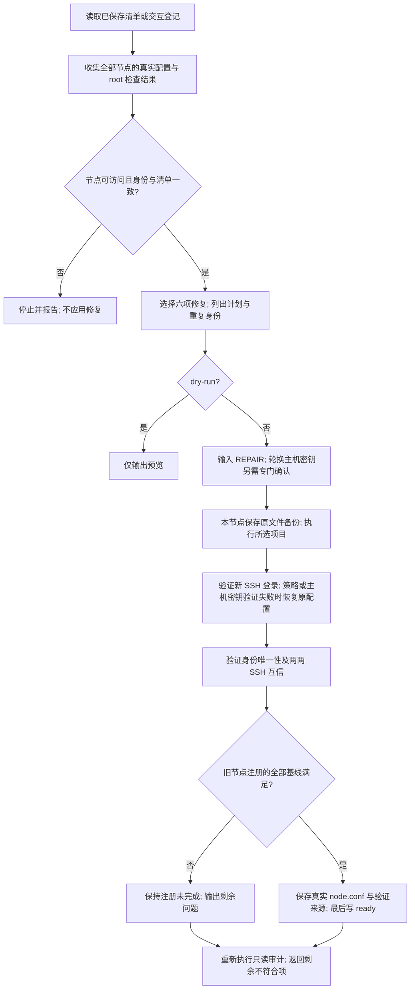

# 旧集群基线修复功能设计

阅读位置：`01.03` · 功能域：集群部署与配置 · [返回文档导航](../00-文档导航.md)。

`02-deploy-cluster.sh --repair` 面向已运行集群的主机基线补齐。与完整部署入口分开；不调用安装阶段，不升级包、不更改网络或机器 ID、不移动组件数据、不执行 kubeadm。

## 工作流程

## 安全边界

- 先核对节点清单、hostname、地址和 SSH 身份；信息不匹配或节点不可访问时停止，不改动节点。
- 预览只读取并展示差异；实际修复必须由管理员在交互终端明确确认。
- 修复前保留原文件和权限，逐项应用 hosts、SSH/sudo 或节点身份相关配置，并验证新连接。
- 修复失败时保留备份和未完成状态，报告剩余问题；不会把部分完成标成集群基线已就绪。
- 不重装 Kubernetes、不升级系统、不更改网络或组件数据，不会自动修改外部客户端的 SSH known_hosts。
- `adopted-baseline.json` 仅表示节点基线检查结果已登记，不代表新装流程、业务功能、HA 切换或数据恢复均已通过。
