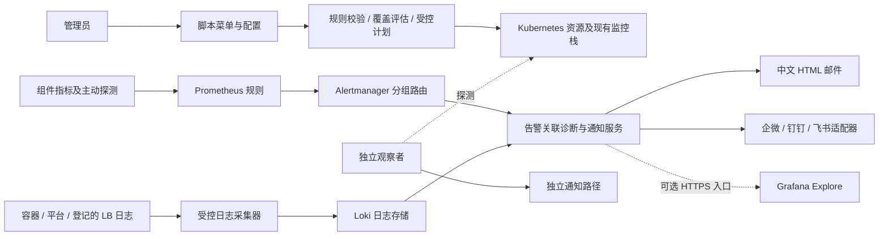

# 0.4.0 监控与告警功能设计

**架构目标：监控中心独立成一套 Kubernetes 集群，应用集群按需接入。** 监控集群运行规则、Alertmanager、Grafana、Loki 和通知组件；应用集群通过采集 Agent 推送指标和日志。部署用途由统一集群配置声明，避免把监控中心误装进业务集群，也避免将监控组件部署到集群外宿主机。

阅读位置：`07.03` · [返回文档导航](../00-文档导航.md)。

状态：0.4.0 已完成候选发布验收，正式版本仍为 0.3.0。节点、控制面、etcd、CoreDNS、Deployment/StatefulSet/DaemonSet、Pod 启动与重启、Job、HPA/KEDA、HAProxy 及 Longhorn 规则已实现，并通过 06 号计划接入采集、规则、邮件和机器人配置；计划只保存 Secret 名称和键引用。HPA 指标不可用、KEDA 错误计数、上游空响应、scaler 延迟及 Operator 目标失联规则已通过 promtool 触发/恢复及中文通知文本验证。03 安装或重配 KEDA 时会启用 Operator 指标；如果 kube-prometheus-stack 已安装，则创建带匹配 release 标签的 ServiceMonitor。KEDA 2.21.0 隔离 Operator E2E 实测了真实指标抓取、scaler DNS 故障告警/恢复，以及删除/恢复 ServiceMonitor 后目标失联告警触发/解除；缺失窗口由 `monitoring-max-age` 控制。若 KEDA 先安装，安装 Prometheus 后须重新运行 03 配置 KEDA。通知默认使用简体中文；告警邮件模板包含状态、规则名称、级别、摘要、处理建议、受影响对象、观测值和发生/恢复时间。SMTP 隔离 E2E 验证了 Alertmanager 0.35.0、中文 HTML 模板、隐式 TLS 和 HTML-only MIME。2026-11-15/16 在 10.20.1.28–.30 隔离集群通过 06 计划发布临时邮件路由，Operator 加载配置，告警触发/恢复各成功提交一封真实 SMTP 邮件；路由、凭据和测试告警已清理。用户确认最新两封邮件在 QQ 客户端均呈现为带摘要、处理建议、对象、状态和时间的中文卡片。企微 Webhook、钉钉和飞书测试群的故障与恢复消息均已由用户确认收到，钉钉和飞书消息包含 `atlas` 关键词。

03 在菜单 4、5 和组合向导中同步已安装的默认日志栈。两个 PodMonitor 在 `monitoring` 命名空间创建，分别从 `logging` 采集 Loki 单副本和 Alloy 的 `http-metrics` 端口。采集仅保留写入行数、字节量、重试与丢弃指标。两分钟未发现目标或抓取失败时告警。Loki 拒收和 Alloy 投递丢弃按已有采样基线比较最近五分钟的计数增量，持续一分钟后告警。自定义多组件 Loki 部署应按实际架构配置采集。

2026-11-17：03 插件 5 新增 Loki/Alloy 引导式配置：QA 收集日志保留天数、StorageClass、PVC 容量和采集命名空间，生成 values 后先安装 Loki、再安装 Alloy。Alloy 使用单实例 Deployment 通过 Kubernetes API 采集 Pod 日志，避免每个 DaemonSet 副本重复读取全群 Pod 日志。默认 Loki 使用 PVC 的单副本文件系统存储，不具备 HA；生产高可用需要外部对象存储及专门配置。Loki 21.3.1、Alloy 1.16.0 上游 Helm 渲染及 Alloy 配置校验通过；曾在隔离 Kind v1.36.1 集群用唯一 Pod 日志标记验证采集和 Loki API 查询，PVC 已绑定，临时集群已清理。03 菜单 18 提供逐条通知路由向导，菜单 19 新增按 Prometheus→Loki/Alloy→通知顺序串联现有 QA 的入口；会检查并复用既有 release、等待监控核心 StatefulSet 与日志 Pod Ready，后续取消/失败时保留已完成阶段提示续跑。每个通知渠道仍通过独立 06 计划预览和确认，因此总流程不是单一原子事务。通知凭据经隐藏输入和标准输入写入 Secret，机器人 endpoint 限制为对应官方 HTTPS 主机。新增单元测试覆盖序列顺序、就绪检查、凭据 stdin、endpoint 限制及取消状态。2026-11-17 在保留的 10.20.1.28–.30 三节点集群实际运行菜单 19：发现并修复 Prometheus/Alertmanager StatefulSet 名称硬编码错误；复用两个既有 release 后 Ready 检查通过，Loki 5 Gi Longhorn PVC Bound，Loki 与 Alloy 均 Ready。Loki API 查询到 46 个日志流、15 个监控或 Longhorn 容器实例（分别 4 和 11），Alloy 写入计数器记录 88,843 条成功发送，丢弃计数为 0。此后已完成无自建镜像前置条件的通知链路改造：中继 Python zipapp 与语言文件存放在不可变内容寻址 ConfigMap，使用按镜像源改写的固定 digest Python 运行时。2026-11-18 在同一三节点集群实际拉取镜像、应用 06 通知计划、验证 Alertmanager 选路，并向真实企微测试 Webhook 发送中文 firing/resolved 消息；平台接受两条消息，中继 accepted=2，unknown/retryable/rejected 均为 0。测试规则、路由、凭据、sidecar 和端口转发已清理，Alertmanager 恢复为 2/2 Ready。2026-11-18 同一三节点集群另完成真实 Loki 日志诊断 E2E：Pod/容器精确 selector 与仅节点标签 selector 均命中临时 Pod 的唯一 marker，并验证中文告警正文；无 Grafana 入口时不附链接，配置 HTTPS URL 与 datasource UID 后生成 Explore 链接。为支持节点级告警关联，Alloy 显式发布 namespace、pod、container、node 标签；配置通过 Alloy v1.22.0 实际校验器，chart 1.16.0 已升级到 revision 2 并完成 rollout。临时 Pod、Job、ConfigMap 已清理。relay 邮件/机器人集成测试捕获并核对两种正文；用户未提供生产 Grafana 域名，真实 DNS、证书链及手机外网可达性仍未验收。

节点运行时监控新增主机侧 systemd 定时采集器：02 号节点准备阶段在 cp/worker 安装受管 oneshot 服务与 30 秒 timer，仅读取 kubelet、containerd 的 LoadState/ActiveState，并原子写入受管 Prometheus textfile；03 号脚本只读挂载该目录并启用 node-exporter textfile collector，同时创建中文的服务不可用和数据缺失/过期告警。已有集群可在 06 号运维脚本创建 `monitoring-systemd-collection` 变更计划，按节点预览、确认、分步安装并支持失败后续作。采集器不挂载容器 D-Bus，也不提高 node-exporter 权限。2026-11-16 在 10.20.1.28–.30 隔离集群通过 06 计划为 cp1/w1/w2 安装并核验 timer、样本和 kubelet/containerd 状态；使用 kube-prometheus-stack 93.3.0 的 03 安全默认值配置后，node-exporter 3/3 Ready，textfile hostPath 只读挂载，Prometheus 已抓到三节点样本。真实停止 w2 kubelet 后中文 `AtlasKubeletServiceUnavailable` 告警进入 firing；恢复服务后 w2 Ready、告警 inactive。未验证该次故障的外发通知送达。03 完整交互首次安装已在干净的一节点和三节点 Kind 集群通过；保留三节点集群也完成监控集成、真实通知与日志诊断闭环 E2E。其他目标生产拓扑的首装仍需按环境验收。

2026-11-16 合并运行隔离 Operator E2E 的 self-monitoring、邮件、机器人、HAProxy、Longhorn 采集、工作负载及控制器场景并通过。Operator 选择了 HTML-only 邮件及 Secret 引用机器人配置；Prometheus 实际抓取 HAProxy、受控 Longhorn 指标与认证的模拟通知中继。中继失败计数触发中文告警并在五分钟观测窗口后解除；Deployment、StatefulSet、DaemonSet 告警均通过健康、故障、恢复验证。临时 Kind 集群已核实删除。该组合测试不发送真实渠道通知，不代表 NetworkPolicy 已生效，也不替代 Longhorn CSI 故障恢复 E2E；后者见下方独立三节点验证记录。

同日另在干净的一节点 Kind 集群完整交互运行 `03-install-addons.sh --lang zh_CN` 首装 kube-prometheus-stack 93.3.0。Chart 所有 Pod Ready，Prometheus API 检查到 253 条健康规则，Atlas Alertmanager/systemd 规则加载正常、node-exporter 目标 up；未创建 kube-proxy ServiceMonitor，Grafana 策略为 Recreate。此验收使用临时存储，只证明 03 首装路径在该 Kubernetes 版本通过，不替代多节点首次部署和持久化存储验收。

同日另在干净的三节点 Kind v1.36.1 集群完整交互运行 03 首装同版 Chart。三个 Kind 节点 Ready、全部监控 Pod Ready，Prometheus 加载 253 条规则且无不健康规则，Atlas Alertmanager/systemd 规则健康，node-exporter 三节点目标均 up；Alertmanager 已配置 `atlas-kubekit.io/managed-by=monitoring` 选择器及 `OnNamespaceExceptForAlertmanagerNamespace` 匹配策略，Grafana 为 Recreate。共发现 25 个 active targets，其中 22 个 up；down 的三个是 Kind 控制面 Scheduler、Controller Manager 和 etcd 的 loopback 指标端点。Kind 未执行 02 的主机指标接线步骤，因此这是测试环境限制，不能替代真实集群控制面目标验收。镜像拉取代理只在宿主机可达，测试将固定镜像导入临时 Kind 集群后继续完成；集群和 kubeconfig 均已清理。该结果补充三节点插件首装证据，不等于真实多控制面或持久化存储验收。

2026-11-14 临时三节点 Cilium/Longhorn 集群完成手动真实卷副本故障恢复：停止 worker 上的 kubelet/containerd 使节点转为 NotReady，暂停该节点 Longhorn 调度并删除一个卷副本 CR；保留的副本继续提供卷。Prometheus 检测到卷降级并触发告警；恢复节点调度后第二副本重建、卷恢复 healthy、告警解除且数据校验和一致。Alertmanager 已向 SMTP 提交故障/恢复邮件。

2026-11-15 在保留的 110–114 号隔离集群运行仓库中的 `monitoring_longhorn_failure.py` E2E 并通过：w1/w2 初始各有一份副本，哨兵 SHA256 为 `bcf87373248db555c8254170f24d47caa7b690da1d398979fa5566212269c94f`；移除 w1 的演练副本后 Prometheus 观察到 degraded 并触发规则，w2 上的哨兵数据校验不变；恢复调度后两份副本运行、指标恢复 healthy、告警解除、SHA256 再次一致。临时 Namespace/PVC、StorageClass 和 PrometheusRule 均已核实清理，Longhorn 节点原调度状态已恢复。2026-11-16 在 10.20.1.28–.30 集群复跑时发现 `kubectl exec -i` 流式写入即使分块仍会截断；脚本现改用命名空间内的只读 ConfigMap 种子卷写入哨兵，并在清理阶段等待确认 Longhorn 临时卷删除。此次演练不是 VM 断电，三个节点仍位于同一 Proxmox 宿主机。

实际集群复核发现两个 Longhorn Manager 重复导出的卷指标曾被错误判为多份状态样本，造成健康 PVC 告警；规则现先按样本年龄过滤，再按 PVC、卷和状态聚合，健康 PVC 不再误报。同步修复了超长 PVC 告警标签和 Operator 更新资源版本导致计划误失效的问题。Prometheus 当前实际加载 Longhorn 健康、磁盘和 PVC 规则，实时集群指标下均无 Atlas 存储告警。

2026-11-15 在保留的三节点隔离集群发现 CoreDNS P95 告警由 5 分钟约 33 次请求中的少量慢查询触发。DNS 规则计划已加入可配置的 `--monitoring-dns-min-requests`，默认每窗口至少 100 次查询才评估 P95；低流量慢查询和高流量阈值触发/恢复均通过 promtool。通过 06 变更计划更新集群规则后，Prometheus 实际加载表达式且规则健康、非告警，CoreDNS 风险告警已解除。真实生产阈值仍需结合业务流量校准。

2026-11-15 在保留的 110–114 隔离集群运行 `tests/e2e/monitoring_longhorn_live_netpol.py` 并通过：驱动先核对固定节点身份、Cilium 就绪、Prometheus 选择器及受管 ServiceMonitor/NetworkPolicy；带 Prometheus 标签的 monitoring Job 从 w1 抓取 w2 上真实 Longhorn Manager 的 `longhorn_volume_robustness`，独立命名空间中的无关 Job 被 Cilium 阻断。临时 Job 和命名空间已删除并核实。随后 Prometheus API 显示 26/26 个采集目标 UP，仅有预期的 Watchdog 告警处于 firing。该测试不改监控对象、不做节点故障注入，也不替代生产集群网络策略验收。

本轮控制面指标配置改为在初始化和控制面加入后自动把 etcd、Scheduler、Controller Manager 指标绑定到该节点内网地址，同时更新静态 Pod 健康探针地址并保留原始清单备份。隔离集群 Prometheus 实际采集到这三类目标，Longhorn 两个节点的磁盘指标也已采集。独立观察服务部署在 LB1 的用户级 systemd 中，探测 API VIP；双 LB 的 HAProxy 停止时观察者记录故障并获企微平台接受响应，HAProxy 恢复后探测与告警恢复。平台接受响应不等于收件人确认收到本次两条消息。

控制面配置脚本由 `init-cluster.sh` 在 `kubeadm init` 成功后调用，也由 `join-nodes.sh` 在控制面节点加入后调用。它将 etcd metrics URL、Scheduler/Controller Manager metrics bind address 和对应静态 Pod readiness/liveness probe 地址设为本机节点 IP，先保留原清单，再原子替换；随后等待静态 Pod Ready、核对三个端口绑定该节点 IP，并检查 API `/readyz`。配置仅开放于节点私网地址，不改用 `0.0.0.0`。现有集群可用 `bash scripts/stages/configure-control-plane-metrics.sh <本机节点IP>` 幂等执行修复。新部署副本需要包含该阶段脚本。

kube-proxy 的 metricsBindAddress 为空时默认只监听 loopback。03 安装 Prometheus stack 时现已默认关闭该 ServiceMonitor 及依赖它的默认 kube-proxy 告警，避免不可达目标造成误报；管理员只有在为 metricsBindAddress 配置了受访问控制的可达地址后，才应通过自定义 values 显式启用。Grafana 默认使用 Recreate 更新策略，避免单副本部署在滚动更新时被旧 Pod 占用的 ReadWriteOnce 卷卡住；升级会有短暂界面中断。当前隔离集群未验证这项安全远程采集，因此该风险保持未覆盖。部分控制面目标也需按实际发现配置，不能把规则创建成功等同于覆盖完成。不要为了消除告警直接把 metrics 端口暴露给不受限网络。独立观察服务已在 LB1 的 Linux 用户级 systemd 中完成 API VIP 故障/恢复实测，但 LB、集群和观察者同处一台 Proxmox 主机，不能证明独立物理故障域。企微、钉钉、飞书测试群均确认收到故障与恢复样例；独立观察器进程 watchdog/OnFailure 故障通知及自动重启已通过隔离 systemd E2E，跨物理故障域故障注入、完整生产风险覆盖审计和长期稳定性仍待完成。Longhorn E2E 临时 Namespace/PVC、StorageClass 和演练规则已清理；110–114 隔离集群保留供后续验证。目标与风险定义见[功能定义](01-生产监控与预警功能定义.md)和[覆盖矩阵](02-生产监控指标与告警覆盖矩阵.md)；版本目标见[产品路线图](../09-产品路线图/01-版本里程碑与能力规划.md)。

## 用户流程

1. 管理员登记集群、在用组件、关键入口和接收责任组，填写规则阈值、时间窗口及渠道凭据引用。
2. 脚本发现现有监控组件与 API，比较预期对象、实际采集和权限，列出覆盖项、缺口和不能验证的项目。
3. 管理员预览规则、通知路由和预期资源变更；确认前校验依赖、版本、配置归属和凭据引用。
4. 通过受控计划发布并检查实际生效状态；失败报告具体阶段，提供有限范围的恢复路径。
5. 用户对授权的测试目标验证故障、恢复与通知送达，在状态视图中查看监控自身、渠道和外部观察的健康情况。

首次配置应在 03 插件安装流程中提供“监控与告警一键配置”向导；不是要求用户分别手工安装 Loki、采集器、诊断服务和通知路由。最终目标是生成单一可预览、可确认、可续作的计划；已安装的监控栈可复用，不覆盖非 Atlas 管理资源。当前 0.4.0 菜单 19 已提供按依赖顺序串联的引导流程，但仍复用各插件安装 QA 和每条通知路由各自的 06 计划，尚未收敛成跨阶段单一变更计划。计划完成后，06 用同一能力检查状态、补配或更新单个部分。

向导按需询问以下信息，默认值只作为可调整建议，不代替环境负责人批准：

| QA 信息 | 向导收集内容 | 未提供时的行为 |
| --- | --- | --- |
| 启用范围 | 是否启用告警关联日志；纳入的命名空间、平台组件和已登记 LB 节点 | 不采集未选择范围；报告未覆盖范围 |
| 日志保留与容量 | 保留时间、日志存储方式/现有 StorageClass、容量或对象存储参数 | 缺少必需存储配置时，只安装已有指标能力并明确诊断日志未启用；不使用无持久化的生产默认值 |
| 通知渠道 | 邮件、企微、钉钉、飞书，可多选；接收方/群、责任组、通知语言；邮件还需 SMTP 主机、端口、发件人与收件人，机器人需相应 Webhook 类型和平台约束（如关键词/签名） | 可跳过渠道配置，但报告通知未就绪；不声称已送达 |
| 凭据引用 | 每个启用渠道对应的 Secret 名称和键，或由交互终端安全采集并写入目标 Secret | 不在普通命令行、计划、日志和报告中回显密码、Webhook 或签名密钥；取消输入则跳过相应渠道 |
| 诊断入口 | 可选的外部 HTTPS Grafana Explore 基址；域名、Ingress/Gateway 或反向代理、TLS 证书和认证策略由环境管理员在相应入口层配置 | 不生成任何外部链接；通知直接附有限大小的相关日志片段 |
| 资源与权限 | 集群版本、监控栈版本、存储/CRD、RBAC、可用资源及镜像来源 | 必要检查失败时停止受影响阶段，保留已完成阶段和续作计划 |

用户可在向导中选择“只部署指标与规则”“指标、规则和通知”“完整诊断闭环”。完整诊断闭环包含受控日志采集、告警关联日志、通知渠道和可选外部链接。推荐路径是完整闭环；缺少存储或日志源时允许先安装其余能力，但必须将诊断部分标记为待完成，而不能把流程显示为全部成功。

## 架构与职责



现有 `03-install-addons.sh` 已支持安装 kube-prometheus-stack，配置 Prometheus retention、三组件存储和 Grafana 密码；它不负责生产风险覆盖、告警路由或外部送达。`06` 已有集群身份、观察指纹、到期时间、确认和锁的计划机制。监控部署与变更复用这些机制，先核对实际对象和归属，再扩展能力；不能覆盖用户自建的 Helm values、Alertmanager 配置或非本工具管理的规则。

`monitoring-resource-remove` 在 `06` 中使用同一计划、确认、审计和集群锁流程，移除单个 Atlas 受管资源。当前白名单限于 PrometheusRule、ServiceMonitor、PodMonitor、AlertmanagerConfig 和 NetworkPolicy；对象必须带 `atlas-kubekit.io/managed-by=monitoring`，且 `atlas-kubekit.io/spec-sha256` 必须与当前 `spec` 完全一致。预览记录对象 UID 与 resourceVersion；执行时 Kubernetes API 再校验两者，目标漂移或被替换时拒绝删除。Secret、PVC、集群级对象、非 Atlas 对象以及主机侧服务不在此能力范围内。

示例（先生成计划，不会立即删除）：

```bash
./06-maintain-cluster.sh --lang zh_CN --change-plan \
  --operation monitoring-resource-remove \
  --monitoring-resource-kind prometheusrule \
  --monitoring-resource-namespace monitoring \
  --monitoring-resource-name atlas-node-readiness \
  --config /path/to/cluster.json \
  --control-target ops@控制面地址
```

核对计划中资源类型、命名空间、名称和 UID 后，再使用输出的计划文件和完整计划 ID 执行
`--change-apply --plan-file ... --confirm ...`。若对象在预览后发生变化，应重新生成计划；不能复用旧计划强制删除。

Prometheus 负责采集和规则求值，Alertmanager 负责分组、抑制、静默及路由。未启用日志关联时，邮件可继续使用 Alertmanager 原生接收方；启用告警关联日志后，Alertmanager 必须将该路由交给诊断通知服务，由它统一查询日志并通过邮件/机器人 Adapter 投递，避免原生邮件与诊断服务重复发送。Alertmanager 通用 webhook 支持故障和恢复事件，但真实语义和超时以安装的版本为准；参考 [Alertmanager 配置](https://prometheus.io/docs/alerting/latest/configuration/)和 [Prometheus Operator 告警路由](https://prometheus-operator.dev/docs/developer/alerting/)。具体 Chart、Operator API 和四种渠道的版本与协议须在实现前逐项核对。

## 功能范围与结果

| 能力 | 首批交付要求 | 未满足时 |
| --- | --- | --- |
| 监控对象与覆盖 | 按风险 ID 登记预期对象、在用组件、采集来源、规则和渠道，展示对象及风险的覆盖状态 | 缺失、权限不足或数据陈旧显示缺口，不标健康 |
| 规则 | 节点、API/etcd、工作负载、网络/DNS、存储、LB 和监控自身先选定关键规则；参数、恢复条件和缺失处理显式配置 | 指标不可用、版本不兼容或参数不足时拒绝发布对应规则 |
| 通知 | 邮件及三类群机器人支持故障/恢复、分组、路由、测试和失败诊断 | 未配置或未验证渠道显示未就绪，不计入送达 |
| 告警关联诊断 | 按告警对象和时间窗口从 Loki 查询相关日志，筛选并以有界片段附入中文邮件/机器人；可选附加受保护的 Grafana Explore 链接 | 日志源缺失、查询失败或无匹配时明确说明状态，不将“无日志”解释为无故障，不附 Prometheus、Alertmanager 或 Longhorn 管理入口 |
| 独立观察 | 独立于被监控集群的执行位置、探测和通知；记录宿主机/网络等共同故障域 | 无独立位置或通路时显示未覆盖，不能以集群内探测替代 |
| 使用与变更 | 菜单复用三语言 messageKey；版本化配置、预览、确认、归属、冲突检查和报告 | 未通过检查停止变更；不自动替换已有第三方配置 |

### 03 首装的一键监控与诊断配置

03 向导负责收集输入和发起部署。目标设计复用 06 已批准的 Facade/Command：Facade 协调采集、存储、规则、通知和入口阶段；Command 保存不可变输入摘要与资源变更计划，统一预览、确认、执行、失败续作和报告。当前菜单 19 是可续跑的阶段协调器，各阶段继续调用既有 QA/06 计划；后续需要在不绕过阶段级安全校验的前提下，将完整 QA 结果汇总为一次总预览和跨阶段续作报告。渠道协议继续由 Adapter 隔离。密码、Webhook、TLS 私钥等敏感值只落入受限 Secret；计划仅记录 Secret 引用、键是否存在和版本摘要。

一键流程按以下阶段执行，并在每一阶段之后核验实际状态：

1. **发现与规划**：识别已有 kube-prometheus-stack、Loki、Grafana、Alertmanager、存储类、登记组件及第三方资源；检查版本/API、权限、镜像可达性、资源容量和所有权冲突，展示完整计划与输入缺口。
2. **指标与规则**：复用或安装 Prometheus stack，接入适用目标和规则，保留现有 values；逐项检查目标、规则选择和新鲜度。
3. **日志管道**：按 QA 范围安装/配置 Loki 与 Alloy（或支持的等价采集器），设置持久化、保留期、标签和访问控制；仅采集所选业务/平台/LB 来源，不默认汇聚所有主机日志。
4. **诊断通知**：Alertmanager 将告警交给诊断通知服务；服务按受支持的风险 ID/告警类型、对象标签和已登记查询模板确定日志源，使用可配置的前后时间窗口查询 Loki。不得把任意告警标签直接拼成任意 LogQL。服务去重/过滤明显无关行、脱敏常见凭据，按每条告警及整组消息的行数/字节上限截断，再使用邮件 HTML 与机器人 Adapter 发送。超时、无日志、日志源缺失、权限失败和截断均作为消息中的独立诊断状态。
5. **可选访问链接**：只有显式配置了格式有效的公网 HTTPS Grafana Explore 基址，才生成日志查询链接。安装向导只检查 HTTPS scheme、主机名格式和禁止内部地址；不创建 Grafana Ingress/Gateway，不安装 TLS Secret，也不会从公网验证 DNS、证书链、认证策略或手机端可达性。QA 应在填写前由管理员配置入口域名、证书和访问控制，并确认外部用户可访问。没有配置或 URL 格式不合法时隐藏链接，仍按第 4 阶段发送有限日志摘要。
6. **端到端验收**：通过合成告警与测试日志验证采集、关联查询、截断/脱敏、通知触发和恢复；分别核验有链接/无链接路径、查询失败降级、配置持久化和计划续作。只有实际收到测试通知后，渠道状态才记为“送达已验证”。

告警关联窗口、单告警最大日志行数和单条通知最大字节数都须可配置并有硬上限；初始值应由详细实现设计和测试确定，不能把不受限的整段日志或整台服务器日志发入邮件。用户需在上线前确认敏感信息范围、合规保留期与容量。通知无论采用邮件还是机器人，都使用同一份有界诊断内容；避免邮件和机器人因两条独立链路而展示不同故障证据。

诊断服务只能访问 Loki 查询 API 和已登记的通知凭据，不需要 Kubernetes 管理权限，也不返回原始 Secret。日志链接只指向受保护的 Grafana Explore 查询，不指向 Prometheus、Alertmanager 或 Longhorn UI；Longhorn 告警的诊断证据仍来自相关组件日志，Longhorn 自身入口不是日志详情服务。对于无公网 HTTPS 入口的环境，内联摘要是完整默认体验，而不是部署失败。

### 工作负载健康规则设计

工作负载健康使用 kube-state-metrics 暴露的 Kubernetes 状态，不要求在应用容器中安装探针。规则由 `monitoring-workload-health-rules` 计划一次性发布，检查 Prometheus 选择器与受管 PrometheusRule 归属；告警集合固定，不接受任意 PromQL。默认关注持续 Pending、镜像/配置/启动失败、短时间容器重启突增、伴随重启的 OOMKilled、失败或超时 Job、未暂停 CronJob 的计划逾期、HPA 持续到达副本上限或报告扩容受限。Job 超时默认 3600 秒，CronJob 计划逾期宽限默认 900 秒；两者都能在计划时配置。Job 的合理运行时长和 CronJob 的合理宽限取决于业务，管理员应按任务性质、调度频率和容忍时延调整。Job/CronJob 指标缺失或过期时不触发这些超时告警。

| 证据层 | 场景 | 通过条件 |
| --- | --- | --- |
| PromQL | 每条规则的触发、恢复、阈值边界、陈旧样本及标签 | 固定 promtool 逐条评估；不能靠静态检查声称触发/恢复通过 |
| Operator | kube-state-metrics 指标与 PrometheusRule 真实选中 | 10.20.1.28–.30 隔离三节点集群真实触发/恢复 Pending、运行超时 Job 与逾期 CronJob 告警；Job/CronJob 使用 60 秒临时阈值，CronJob 场景短暂停止 kube-controller-manager 并构造历史计划时间，测试后恢复控制器、删除临时规则和 namespace，告警归零且节点 Ready。尚未等待默认 3600 秒 Job 时限，也未验证生产调度器长期故障 |
| 清理 | 专属命名空间中的测试资源 | 测试 Job/Pod/HPA 和 Namespace 删除，并核实不存在 |

该首批规则不把一次普通重启直接等同 OOM；OOM 需与重启增量关联。CronJob 告警以 kube-state-metrics 计算的下一次启动时间和固定宽限判断，暂停任务不告警；它不能判断业务是否有意跳过运行，也不替代每个任务的成功时限与时区化业务 SLO。KEDA 规则涵盖 scaler 错误计数、ScaledObject 错误计数、上游空响应、scaler 指标延迟和 Operator 目标不可用/持续缺失；目标缺失使用 `absent_over_time` 并以 `monitoring-max-age` 作为窗口。03 会在 KEDA 安装/重配时启用 Operator 指标，并可由 kube-prometheus-stack 选择 ServiceMonitor。KEDA 2.21.0 的隔离 Operator E2E 已验证实际抓取、Prometheus scaler DNS 故障触发中文 ScaledObject 告警及修复后 Ready/告警恢复，并验证删除/恢复 ServiceMonitor 后目标告警触发/解除；测试使用 Kind，临时集群已删除。E2E 确认工作负载 namespace 标签经 Prometheus 重命名为 `exported_namespace`，规则和通知已按此处理。HPA 的 `ScalingActive=false` 会提示扩缩指标异常；尚未覆盖 HPA/KEDA 外部指标源全部失效，也不替代业务自定义伸缩指标 SLO。Deployment 发布 generation 和探针失败仍是独立缺口。

风险矩阵是目标清单，不是已实现的 PromQL。规则逐项确定真实指标及版本、单位、标签、阈值、持续窗口、恢复条件、缺失判定、责任组和操作指引；业务成功条件由用户提供。插件未安装时按适用性解释，在用组件的采集缺口不得自动归为不适用。

## 已开发的只读检查（未发布）

开发源码中的 06 提供 `--monitoring-inspect`：读取 Kubernetes 节点 Ready 状态、`monitoring` 命名空间及工作负载数量；可选查询 Prometheus 的节点 Ready 样本，区分正常、未就绪、缺失、过期和重复。运行账号须有对应读取权限。该操作保存私有报告，始终返回未验证状态（退出码 2），不会创建规则或发送通知。

```bash
bash ./06-maintain-cluster.sh --lang zh_CN --monitoring-inspect \
  --kubeconfig /etc/kubernetes/admin.conf \
  --prometheus-url http://127.0.0.1:19090 --monitoring-max-age 120
```

Prometheus 地址是运行脚本的机器可访问的基础地址；示例需要先自行建立到实际 Prometheus 服务的本机端口转发。HTTP 仅接受回环 IP，远端地址使用 HTTPS；地址中不要包含凭据。可省略 `--prometheus-url` 仅检查 Kubernetes 清单。样本最大年龄可配置，默认 120 秒；检查分别读取节点状态和原始样本时间，并使用同一求值时间，不能将查询时间当成样本时间。查询失败、两次查询的序列不一致、缺权限或数据不唯一时不判为健康。当前检查不验证告警规则、渠道送达或其他命名空间，不能代替持续监控。

逐风险覆盖检查沿用风险矩阵 ID，并比对 Kubernetes 中的告警声明和指定 Prometheus 端点的 `/api/v1/rules`。默认只有“通用”风险自动列为必需。“在用”和“扩展”风险须通过私有 JSON 范围文件明确登记为必需或附理由排除。采集与通知拥有各自的验收要求，检查始终以未验证状态退出。

`ruleEvidence` 根据 Operator 规则文件名中的命名空间、资源名和 UID，再比对规则组、告警名和静态标签。每条声明都须在指定端点找到数量一致且求值健康的规则。漏载、重复匹配、标签差异和求值错误会列到对应资源。来源不可核对或求值健康未知时保留未验证。若集群有多套 Prometheus、使用规则选择器隔离资源，或通过 Operator 额外强制写入标签，应按该端点的部署配置检查这些差异。当前证据验证加载身份与求值健康。在同一 UID 下更新 PromQL 时，仍需专项验收表达式版本、触发和恢复。[Prometheus Operator 规则文件命名实现](https://github.com/prometheus-operator/prometheus-operator/blob/main/pkg/operator/rules.go)

开发源码可生成完整风险清单报告；不提供范围文件时，“在用”和“扩展”风险保持范围未登记，不会被误标为不适用。范围文件只接受显式列出的风险，未列出的风险继续未验证；“通用”基线风险不能排除。为避免每次检查都重新输入目标参数，范围文件可同时保存完整预期目标清单、风险到 Prometheus 目标映射和风险到观察探针映射；旧版仅有 `schemaVersion`/`risks` 的文件继续兼容：

[机器可读示例档案](../../examples/monitoring-scope.example.json) 展示了文件格式。示例主机名与抓取池仅供说明；部署时应从当前集群 Prometheus Target API 复制准确身份，并由集群负责人确认完整清单和每个风险的关系。

```json
{
  "schemaVersion": 1,
  "risks": [
    {"riskId": "R-LB-01", "applicability": "required"},
    {"riskId": "R-INFRA-01", "applicability": "not-applicable", "reason": "目标集群不运行在 Proxmox 上"}
  ],
  "expectedTargets": [
    {"scrapePool": "serviceMonitor/monitoring/node-exporter/0", "job": "node-exporter", "instance": "10.20.1.28:9100"}
  ],
  "riskTargets": [
    {"riskId": "R-NODE-03", "scrapePool": "serviceMonitor/monitoring/node-exporter/0", "job": "node-exporter", "instance": "10.20.1.28:9100"}
  ],
  "riskMetrics": [
    {"riskId": "R-NODE-03", "scrapePool": "serviceMonitor/monitoring/node-exporter/0", "job": "node-exporter", "instance": "10.20.1.28:9100", "metric": "node_memory_MemAvailable_bytes"}
  ],
  "observerMappings": [
    {"riskId": "R-EDGE-01", "observerName": "api-vip"}
  ]
}
```

目标身份示例须按当前集群 Prometheus Target API 的 `scrapePool/job/instance` 精确值替换。`expectedTargets` 用于完整目标清单对比；`riskTargets` 只表示维护者确认的数据采集关系，不代表风险指标本身已验证；`observerMappings` 只读取运行观察器主机上的状态库，观察路径不会替代 Prometheus 证据。用 CLI 重复提供的目标参数会与文件配置合并，完全相同的条目去重；字段冲突、重复风险目标或未知风险必须拒绝。范围与映射文件不含密钥，可纳入受控配置管理；如目标值含内部地址，应按环境配置权限管理。

验收检查旧版范围文件兼容性，以及新档案的风险范围、预期目标、风险目标、指标样本和独立观察映射。无效版本、未知或重复风险、非法目标字段和格式错误应被拒绝。CLI 与档案重复登记的相同目标应合并。Prometheus 与独立观察器分别输出证据，告警触发与通知送达各有验收记录。

可选的 `riskMetrics` 把样本检查登记到同一风险下已在 `riskTargets` 声明的目标。每项使用指标名与可选的 `labels` 对象。标签使用精确值，可用来区分磁盘、网卡、节点或容器。每项应匹配一条有限值序列，抓取目标须可唯一定位。报告记录原始样本时间及缺失、过期、重复或未验证状态。每个风险的所有登记目标都须有样本检查，全部登记样本新鲜后才确认该风险的数据证据。档案最多登记 128 项检查。私有报告保存指标身份、登记标签和样本时间，指标原始取值留在数据源。请勿在登记标签中填写凭据。环境负责人应确认样本登记覆盖业务所需指标。规则求值和实际通知仍按专项测试验收。

样本检查中的新鲜度指 Prometheus 原始样本时间。采集延迟、应用心跳及 textfile 最后写入时间等业务语义由相应规则判断。例如，`node_textfile_mtime_seconds` 的样本时间可用于确认指标正在被抓取，它的数值才表示文件最后写入时间。

当多个抓取池共享相同的 `job/instance` 时，在 `riskMetrics.labels` 中登记实际目标标签，例如 kubelet 的 `metrics_path: /metrics/cadvisor`、LB 的 `metrics_endpoint` 或 Blackbox 的 `probe_target`。06 根据 Prometheus 活跃目标的最终标签逐一排除其他来源，包括当前抓取失败的目标。选择值与登记的抓取池冲突、共享目标缺少可区分标签，或目标不健康时，对应的样本证据为未验证。JSON 报告的 `sourceLabels` 保留上述三类受限标签，`attribution` 记录每条样本的来源判断；审计检查的是当前 Prometheus 端点和已登记的采集关系。

```bash
bash ./06-maintain-cluster.sh --lang zh_CN --monitoring-coverage \
  --kubeconfig /etc/kubernetes/admin.conf \
  --prometheus-url http://127.0.0.1:19090 \
  --monitoring-expected-target 'serviceMonitor/monitoring/kube-prometheus-stack-prometheus-node-exporter/0|node-exporter|10.20.1.28:9100' \
  --monitoring-expected-target 'serviceMonitor/monitoring/kube-prometheus-stack-prometheus-node-exporter/0|node-exporter|10.20.1.29:9100' \
  --monitoring-risk-target 'R-NODE-01|serviceMonitor/monitoring/kube-prometheus-stack-prometheus-node-exporter/0|node-exporter|10.20.1.28:9100' \
  --monitoring-risk-target 'R-NODE-01|serviceMonitor/monitoring/kube-prometheus-stack-prometheus-node-exporter/0|node-exporter|10.20.1.29:9100' \
  --observer-state-directory /var/lib/atlas-observer \
  --monitoring-observer-risk 'R-EDGE-01|api-vip' \
  --monitoring-scope-file /absolute/path/monitoring-scope.json
```

报告需要读取所有命名空间中的 PrometheusRule，因此执行账号需要集群范围的读取权限；Prometheus 地址可省略，此时规则加载和目标盘点均未验证。`--monitoring-expected-target SCRAPE_POOL|JOB|INSTANCE` 用于全局采集目标差异；`--monitoring-risk-target RISK_ID|SCRAPE_POOL|JOB|INSTANCE` 将一个已登记目标明确关联到风险，支持为一个风险重复登记多个目标，也允许一个目标关联多个风险。目标清单是否完整仍由维护者负责。检查读取 `/api/v1/targets?state=active`，分别呈现缺失、同池重复、down、超龄、未知和未登记目标；不会输出抓取 URL 或原始错误。报告单独记录风险映射目标的健康状态；健康且最近抓取成功只证明端点可访问，不证明该风险对应的指标样本存在或新鲜。除 R-OBS-01（其被核验的信号就是 active target 清单）外，风险数据阶段在没有指标级查询证据时继续保持未验证；目标异常则标记采集链路失败。目标清单完整性、指标语义、规则触发行为和通知真实送达仍需独立验证。

覆盖报告可通过 `--observer-state-directory` 读取同一运行主机上独立观察器的私有状态目录；通过重复的 `--monitoring-observer-risk RISK_ID|OBSERVER_NAME` 将外部探测与风险关联，例如将 `R-EDGE-01|api-vip` 关联到名为 `api-vip` 的观察器探测。读取复用观察器现有只读 SQLite snapshot 契约，不启动/改写服务、不读取 Webhook 凭据，也不把观察器健康混入 Prometheus 的规则、数据与通知三阶段结果。证据分别显示观察器进程锁状态、探测原因和样本时间；进程停止、状态不可读、探测缺失/过期均不能判健康。`R-OBS-04` 自动显示观察器进程及最近探测状态。此功能不检查 systemd 是否设置开机启用，也不证明本轮外部渠道送达；通知送达仍按独立渠道测试结果核验。

`R-OBS-01` 目标盘点还需显式传入完整的预期 `SCRAPE_POOL|JOB|INSTANCE` 清单，并访问 Prometheus `/api/v1/targets`。验收用例应区分目标正常、缺失、同池重复、down、最后抓取超出样本年龄、未登记的额外目标、接口不可达和无权限；未提供清单或无法读取 API 时必须保持未验证。报告只输出抓取池、目标标签与状态，不输出抓取 URL 或原始错误。预期清单的完整性仍由集群负责人确认，审计只能证明已声明范围与当前 active targets 的差异。

企微、钉钉和飞书的文本消息适配代码以及 Alertmanager v4 分组消息解析已有模拟测试。消息转换保留每条告警的故障或恢复状态，并标明 Alertmanager 截断的数量；钉钉和飞书每条消息（含分段）自动加入 `atlas` 关键词。平台返回成功才算平台接受，超时可能已经送达，不能认定成功或承诺不重复。开发源码提供单渠道回环接收服务；隔离容器链路已验证真实 Prometheus 规则求值、Alertmanager 分组、中文规则名/节点/风险编号/摘要/处理说明、故障与恢复、临时拒绝后的重试。用户确认企微测试群收到故障和恢复消息，并确认钉钉、飞书测试群均收到本轮中文触发与恢复消息；这些结果证明渠道可达，不代替监控栈的 Operator 路由选择验收。

企微长消息按实际 JSON 字节限制分段，分段编号标明同组消息；所有分段均获平台确认才确认整组。中途失败会保留失败语义，Alertmanager 重试时此前已送达的分段可能重复。验证覆盖多字节、转义字符、各分段大小、内容完整性和中途失败，不以模拟接收方证明真实企微送达。

分组告警的格式化输出不再因固定文本长度被拒绝；企微、钉钉与飞书按各自完整 JSON 消息字节数分段，签名和平台回执逐段检查。输入请求和告警条数仍有显式资源上限。验证覆盖超 12000 字节、多字节、签名、分段重组、中途失败以及请求边界；通知替身不能证明实际群消息送达或平台限流行为。

平台拒绝也向 Alertmanager 返回可重试状态，避免分段未完整送达却因上游将 4xx 当作不可恢复而停止重试；管理员仍需通过拒绝计数排查凭据、平台限流和配置。格式错误与鉴权失败仍直接拒绝；重试可能产生重复消息。

独立观察已有单进程运行入口、持久队列和直接企微通知代码，并验证过进程重启后的待发送事件顺序。HTTP/HTTPS 目标可检查状态码；HTTPS 可选指定 PEM CA bundle，以验证 Kubernetes 等使用私有 CA 的 API VIP，不关闭证书校验。DNS 模式可指定数字 IP DNS 服务器、业务域名和预期 A/AAAA 地址，按连续失败/恢复次数生成事件。通知使用观察时写入队列的原因码，避免重试期间新样本覆盖待发告警的原因；消息按所选语言说明目标、解析是否符合预期或 HTTP/TLS/连通状态及建议排查方向。06 现可在运行观察者的 Linux 主机用菜单或命令安装/更新当前用户的 systemd 服务，并停止、禁用和移除服务；移除时保留状态数据库和 Webhook 文件。服务以运行用户身份运行，状态目录和 Webhook 文件必须属于该用户且保持私有。该用户服务适合独立 Linux 观察机，不会自动在集群内部安装。

安装或更新独立 DNS 观察服务示例：

```bash
sudo -u observer ./06-maintain-cluster.sh \\
  --monitoring-observer-install \\
  --observer-name business-vip-dns \\
  --observer-dns-server 10.20.1.1 \\
  --observer-dns-name app.example.com \\
  --observer-dns-expected 10.20.1.20 \\
  --observer-wecom-endpoint-file /home/observer/.config/atlas-kubekit/wecom-webhook \\
  --lang zh_CN
```

HTTPS 私有 CA 示例可追加 `--observer-ca-file /etc/kubernetes/pki/ca.crt`；省略该参数时使用系统信任库。该 PEM 文件必须存在于观察主机上。可用 `--monitoring-observer-status --observer-state-directory /绝对路径` 查看状态，或用 `--monitoring-observer-remove --observer-name business-vip-dns --confirm business-vip-dns` 移除服务；状态数据库不会随移除删除。安装命令需要观察主机已登录的 systemd 用户管理器。隔离实测已在 LB1 安装用户级 systemd 服务，并通过停止双 LB 的 HAProxy 验证 API VIP 故障、恢复和企微平台接受响应。2026-11-16 又从集群外的 Mac 运行观察器服务进程，以集群 CA 成功验证隔离集群 `https://10.20.1.31:6443/readyz` 并记录 healthy；这是只读 TLS 连通性验证，不代表 API 故障/恢复消息或 systemd 跨主机部署已验证。观察主机与集群仍共用 Proxmox 宿主机，无法证明物理故障域独立。观察器用户级 systemd 单元使用 `Type=notify`/watchdog 检测卡死进程，并以独立 `OnFailure` oneshot 发送中文故障通知；Ubuntu 24.04/systemd E2E 已验证冻结、重启和本地 HTTPS 协议接收器，未验证企微实际送达此类通知。停止和卸载不触发故障通知。状态锁被持有不能证明进程仍有响应；队列按照发生顺序发送，未确认的旧事件会阻塞后续事件。观察节点故障、跨物理宿主机隔离及 Prometheus/Alertmanager 整体不可用时独立健康信号仍未完成验收。

独立观察诊断扩展：为最近探测和最近投递记录 UTC 时间及有限的结果代码，不保存 URL、凭据、响应正文或异常文本；投递结果与队列确认在同一事务中提交。旧数据库升级不能丢失待发送事件，已有事件没有原因码时采用通用提示。测试覆盖重启、未知/拒绝/重试/成功、顺序、回滚和敏感信息不落盘；状态记录不能证明独立通知真实送达。

业务 DNS 外部探测可在独立 Linux 观察机上运行服务，例如：

```bash
mkdir -p "$HOME/.local/state/atlas-kubekit-observer" && chmod 700 "$HOME/.local/state/atlas-kubekit-observer"
python3 -m scripts.operations.monitoring.observer.service \
  --state-directory "$HOME/.local/state/atlas-kubekit-observer" \
  --name business-vip-dns \
  --dns-server 10.20.1.1 \
  --dns-port 53 \
  --dns-name app.example.com \
  --dns-expected 10.20.1.20 \
  --wecom-endpoint-file /etc/atlas-kubekit/wecom-webhook \
  --lang zh_CN
```

观察机需要能访问指定 DNS 服务器 UDP 端口，Webhook 文件必须由运行用户私有读取。预期地址可重复指定以适配双栈；探测仅比较 A/AAAA 回答，不验证业务 HTTP、集群内部 DNS、递归解析器配置正确性或 DNSSEC。systemd 单元使用用户服务管理器运行，服务与调用用户共享本机账户权限。

邮件使用 Alertmanager 原生接收方，并通过 Secret 引用凭据。正式通知模板包含中文告警状态、规则名称、级别、摘要、处理建议、集群/命名空间/节点或工作负载、观测值、开始/恢复时间和来源；摘要与处理建议来自告警规则注解，帮助接收者识别故障对象并采取行动。为避免邮件客户端选择纯文本备选而隐藏样式，受管路由只配置 HTML 正文。Alertmanager 0.35.0 的 465 隐式 TLS、认证、故障/恢复邮件及中文卡片 HTML 模板通过隔离 SMTP E2E；E2E 检查实际 MIME 只有含行内样式的 HTML 正文。2026-11-15/16 的三节点隔离集群通过 06 计划创建临时 `atlas-email` 路由，Operator 选择 HTML 正文且关闭纯文本备选，Alertmanager 对测试告警触发和恢复各提交真实 SMTP 一封，成功通知计数增加 2、失败计数保持 0。用户已确认两封邮件在 QQ 客户端均呈现为中文告警卡片。该验证证明了计划、Operator 选路、SMTP 提交和本次客户端展示；不证明其他邮件客户端/版本的渲染或生产凭据配置。测试路由、Secret、SSH 隧道和本地计划均已删除。其他 Alertmanager 版本、错误凭据及配置漂移仍需单独验证。

邮件接入使用受管 `AlertmanagerConfig`，通过 Kubernetes Secret 的键引用 SMTP 密码，而非将密码写进计划、日志或报告。计划预览核对 Alertmanager 对配置对象的标签选择器、命名空间匹配策略、目标路由和凭据引用；无法确认选择、路由范围、版本或所有权时停止。2026-11-15/16 的隔离集群验证了计划执行、Operator 实际生成配置、真实 SMTP 故障/恢复邮件提交；用户确认最新两封邮件进入 QQ 邮箱并呈现中文 HTML 卡片。错误凭据、目标 Secret 不可读、配置漂移、重复执行及其他客户端渲染仍待验证。不替换已有 Alertmanager 主配置。

06 已提供 `monitoring-email` 受控计划：先在 Alertmanager 所在命名空间准备包含密码键的 Secret，再填写 SMTP 服务器、发件人、收件人、单个告警级别及该 Secret 的名称和键。运行账号需要读取该 Secret；kubectl 在子进程中读取完整对象，只将 UID、版本和键是否存在输出给运维程序，计划和报告不保存密码。应用前检查资源和凭据版本，原路由保留并允许继续匹配。引导式通知配置给新 Secret 添加安装器所有权、用途和接收器标签。重配渠道时先记录该接收器当前使用的脚本自建凭据，并复用正在使用的共享中继令牌。计划成功后重新检查工作负载、监控配置及存储引用，只有候选 Secret 无引用且 UID 与 resourceVersion 均未变化时才自动删除。失败、仍有引用或读取权限不足时保留待确认的凭据并提示；早期版本未带专属所有权标签的 Secret 不会自动删除。当前仅接受可明确验证的 Alertmanager 版本和配置选择器，以及覆盖集群告警的命名空间策略；不满足时先由管理员调整监控栈配置。执行完成表示资源已写入，Operator 隔离 E2E 检查受管邮件路由和中文模板是否进入最终配置；仍须在目标环境验证真实故障与恢复邮件格式及送达。

通知向导删除每个旧 Secret 前，重新检查同命名空间的工作负载、ServiceAccount、Ingress、已安装的 Prometheus Operator 资源及集群 PV 的 CSI 引用。监控资源包括 Alertmanager 与 AlertmanagerConfig、Prometheus 与 PrometheusAgent、ThanosRuler，以及 ServiceMonitor、PodMonitor、Probe 和 ScrapeConfig。检查包括 SecretKeySelector、挂载列表及 Alertmanager 的显式或默认配置 Secret。有引用或缺少 API 列表读取权限时保留凭据。删除还要求安装器所有权、组件和接收器标签匹配，并由 Kubernetes 核对 Secret UID 和 resourceVersion。外部消费者、非上述 API 的控制器和跨对象并发新增引用需要由运维方协调。计划执行失败或状态不确定时保留旧凭据，写入状态不确定的新凭据也保留并提示。

`--monitoring-inspect` 会额外检查 Atlas 管理的 `atlas-email` 配置是否包含带卡片样式的 HTML 正文，并确认纯文本备选已关闭；只汇报配置状态，不显示收件地址或 Secret。该项用于区分配置缺失与格式缺失；它不代表 Operator 已选中路由，也不能证明 SMTP 实际发送的 MIME 或邮件客户端最终展示效果。若显示纯文本备选仍启用、配置未设置或 HTML 样式缺失，应通过 `monitoring-email` 计划重新发布，再单独验证 Operator 生成配置与实际邮件。

06 另提供 `monitoring-robot` 受控计划，将指定机器人路由的非敏感元数据存入受管 ConfigMap，将 Webhook 与可选签名密钥保持为 Kubernetes Secret 引用，并在 Alertmanager Pod 中加入受限权限的本地通知适配 sidecar。默认运行时使用 SHA-256 固定的 Python 镜像；脚本把中继源码打成确定性 zipapp，并以内容摘要命名的不可变 ConfigMap 发布 zipapp 和三个语言目录。镜像坐标按 03 当前选择的下载源改写；企业可在 06 传入自有的摘要固定镜像覆盖默认值。代码 ConfigMap 与 Alertmanager、路由配置一起进行 API 服务端 dry-run，计划记录代码包 UID/资源版本/摘要，应用时拒绝代码漂移；旧摘要 ConfigMap 保留用于回滚。执行前仍要求 Alertmanager 版本、受管配置选择器、命名空间匹配策略和凭据键均可验证。该计划只配置一条指定接收路由和告警级别；执行后状态报告仍标为“实际送达未验证”，平台实际送达必须以告警触发/恢复演练确认。

准备机器人凭据 Secret 后，可以通过 `monitoring-robot` 创建变更计划：

```bash
bash ./06-maintain-cluster.sh --lang zh_CN --change-plan --operation monitoring-robot \\
  --monitoring-namespace monitoring --monitoring-release stack \\
  --monitoring-alertmanager-name ALERTMANAGER --monitoring-alertmanager-version 0.28.1 \\
  --monitoring-relay-auth-secret atlas-relay-auth --monitoring-relay-auth-key token \\
  --monitoring-robot-kind wecom --monitoring-robot-receiver ops-wecom \\
  --monitoring-robot-secret ops-wecom-webhook --monitoring-robot-endpoint-key url \\
  --monitoring-robot-signing-key - --monitoring-severity warning \\
  --monitoring-notification-language zh_CN
# 检查计划预览后，用该计划 ID 执行 --change-apply。
```

默认无需预先构建/推送中继镜像；脚本自动发布不可变代码 ConfigMap，并使用选定下载源可达的固定 Python 镜像。如企业需要自有运行镜像，可追加 `--monitoring-relay-image registry.example.com/python@sha256:SHA256_DIGEST` 覆盖。两种 Secret 均须预先存在于 Alertmanager 命名空间；Webhook URL、签名密钥和 relay 鉴权 token 都不会放进命令参数、计划正文或日志，命令行只传 Secret 名称与键。`--monitoring-robot-signing-key -` 表示该渠道不使用签名。执行若在多个 Kubernetes 资源之间中断，会报告已写资源，需先检查现场再创建新计划；工具不会声称投递成功。

机器人中继接入后，可用 `monitoring-relay-metrics` 计划采集中继投递计数，并发布投递失败规则。该计划要求 Prometheus 选择器覆盖 PodMonitor 与规则、Alertmanager 已由 `monitoring-robot` 管理，且认证 Secret 和键位于监控命名空间。采集只使用 Bearer Secret 引用，不把 token 写入计划。执行后需确认 Prometheus 发现带受管标签的 Alertmanager Pod、成功抓取 `/metrics`，并单独验证失败计数触发及恢复；计划完成只代表两个 Kubernetes 对象已写入。

```bash
bash ./06-maintain-cluster.sh --lang zh_CN --change-plan --operation monitoring-relay-metrics \\
  --monitoring-namespace monitoring --monitoring-release stack \\
  --monitoring-prometheus-name prometheus-stack \\
  --monitoring-relay-auth-secret atlas-relay-auth --monitoring-relay-auth-key token
# 检查计划预览后，用该计划 ID 执行 --change-apply。
```

此规则将 5 分钟内 `unknown`、可重试或拒绝结果的累计增量作为通知通道故障信号；它不保存或展示队列内容，也不能证明下游平台已送达。中继 webhook 只监听 Alertmanager Pod 的 loopback，Prometheus 指标使用独立的 Pod IP 端口并要求 Bearer 鉴权。本轮在 10.20.1.28–.30 隔离集群部署实际中继镜像，由 Prometheus 3.16.0 通过受管 PodMonitor 成功抓取；向本地 webhook 注入无效载荷后，实际失败计数触发 `AtlasNotificationDeliveryFailure`，五分钟窗口过期后告警恢复。测试不访问外部渠道，也不证明外部平台投递失败语义；计数仍是进程内状态，进程重启会归零。

首次通过 03 安装监控栈时，可选择启用受管邮件路由前置配置。该选择使监控命名空间中的受管配置可以匹配集群告警，并让选择器仅发现 Atlas 管理的 AlertmanagerConfig；自行创建的配置需要另外调整选择器。该选项不会自动创建 SMTP Secret 或发送消息，额外 Helm values 也可能覆盖它。已有监控栈的配置不会因该选项自动改写。

```bash
bash ./06-maintain-cluster.sh --lang zh_CN --change-plan --operation monitoring-email \
  --monitoring-namespace monitoring --monitoring-release stack \
  --monitoring-alertmanager-name ALERTMANAGER --monitoring-alertmanager-version 0.28.1 \
  --monitoring-smtp-host smtp.example.com --monitoring-smtp-port 465 \
  --monitoring-email-sender sender@example.com --monitoring-email-username sender@example.com \
  --monitoring-email-recipient receiver@example.com \
  --monitoring-email-secret smtp-auth --monitoring-email-secret-key password \
  --monitoring-severity warning
```

计划文件和报告不包含 SMTP 密码，但包含邮箱地址和 Secret 引用，应按运维资料管理。配置同一级别的多个接收方、其他级别或多条自定义路由目前不由该入口管理。

邮件主题和正文、机器人正文的通知语言由 `--monitoring-notification-language` 单独选择，默认简体中文 `zh_CN`，不跟随 CLI 菜单语言；可选 `en`、`zh_CN`、`zh_TW`。该语言也用于本工具发布的告警规则摘要和处理建议；新语言需重新发布对应规则，已存在的规则不会因邮件路由变更自动改写。外部规则的描述保留其原文。主题优先显示告警摘要，缺少摘要时回退到已知告警规则的本地化名称。正文呈现每条告警的触发或恢复状态、规则名称、级别、摘要、处理说明，以及可用的集群、命名空间、节点、Pod、工作负载、PVC、服务、采集目标、风险编号、观测值、告警指纹、开始/恢复时间和告警源。摘要或处理说明缺失时会明确标出，避免只收到空白或机器告警名。数值阈值规则可提供实际观测值；复合健康/缺失规则主要给出告警对象、命中的风险编号及判断说明，不把布尔表达式结果伪装成底层指标值。独立观察者通知也按所选语言说明目标故障/恢复，并给出 DNS、LB、TLS 和应用入口排查方向。

## HAProxy 指标采集与 LB 告警

LB 安装阶段会在 HAProxy 上启用原生 Prometheus exporter（TCP 8405，`/metrics`），默认只绑定回环地址；配置管理 CIDR 后才绑定节点地址，并由 HAProxy ACL 限制来源。该 CIDR 必须涵盖 Prometheus 实际访问 HAProxy 时的源地址；节点路由和防火墙仍需允许 TCP 8405。

06 的 `monitoring-lb` 单一变更计划同时预览并配置 HAProxy 状态页/exporter 来源 CIDR、为登记 LB 建立静态 Endpoints、headless Service、ServiceMonitor，以及告警规则。执行按“HAProxy 来源范围 → 采集资源 → 告警规则”分阶段推进，失败后可按计划续作。扩容、缩容或节点地址变更后需要重新运行计划，以更新固定目标清单：

```bash
bash ./06-maintain-cluster.sh --lang zh_CN --change-plan \
  --operation monitoring-lb --config /path/to/cluster.json \
  --stats-cidr 10.20.1.0/24 \
  --monitoring-namespace monitoring --monitoring-prometheus-name PROMETHEUS_NAME \
  --monitoring-release stack --monitoring-hold-seconds 60 \
  --monitoring-max-age 120 --monitoring-lb-capacity-percent 80
# 检查计划中的 LB 节点、statsAllowedCIDR、采集资源和规则，再使用计划 ID 执行 --change-apply
```

此 Facade 按顺序配置 HAProxy 来源 ACL、写入采集资源，再发布告警规则；计划预览会展示 HAProxy 访问范围。若中途失败，先确认旧进程已停止并使用 `lock-recover` 按提示解除旧操作锁，然后以失败计划文件运行 `change-continue`。续作会重新读取集群状态，只接受仍符合原预期或已经精确写成目标内容的资源，并生成新的计划 ID；发现其他漂移时停止，要求重新检查。

该规则为每个登记 LB 生成 HAProxy 目标缺失/陈旧告警、后端活动及备份服务器都不可用告警，以及按前端 `maxconn` 使用率计算的容量告警。容量阈值默认 80%，可用 `--monitoring-lb-capacity-percent` 调整。告警正文跟随当前语言。后端规则依赖 `haproxy_backend_active_servers` 和 `haproxy_backend_backup_servers`；容量规则依赖 `haproxy_frontend_current_sessions` 与 `haproxy_frontend_limit_sessions`。没有配置最大连接数的前端不纳入容量百分比判断。2026-11-16 在隔离 kind 集群实测 Facade 写入采集与规则资源，Operator 选中 ServiceMonitor，Prometheus 抓取 HAProxy exporter 指标，后端不可用告警以中文摘要和处理建议触发；kind 集群已清理。同日恢复 10.20.1.28–.33 隔离环境后，确认真实 HAProxy 与 VIP exporter 目标均为 `up`，规则加载健康。停止备用 lb2 的 HAProxy 后，`AtlasLBTargetOrTelemetryMissing` 和 `AtlasLBBackendUnavailableOrMetricsMissing` 进入 firing；恢复后目标 up、告警解除，期间 API VIP 保持健康。通过停止 Keepalived、临时添加/删除重复 VIP、两轮主备切换，分别验证了正常接管、无主告警、双主告警、VIP 漂移阈值触发及恢复；所有场景结束后 VIP 独占回到 lb1，API `/readyz` 正常，漂移告警在 10 分钟窗口结束后解除。真实业务高负载、网络分区、外部到业务全链路和生产队列/容量阈值仍未覆盖。

HAProxy 流量指标本身不能判断 Keepalived 当前主备状态，因此 Facade 同时部署 loopback VIP exporter 并通过受 ACL 保护的 `/vip-metrics` 路由采集。隔离集群已验证正常接管、无持有者、重复持有和重复漂移告警及恢复。网络分区下各 LB 的本地观察仍不等同独立第三方仲裁；客户端到 VIP 的完整业务链路、真实负载容量和生产策略仍需独立探测与验收。配置写入完成本身不表示 Operator 已选中、Prometheus 已抓取或规则已触发，应核对 Target、规则状态及通知。

### VIP 所有权和漂移告警设计

R-LB-04 补充目标是把“当前 VIP 由几台登记 LB 持有”及“持有者变化频率”转为可持续采集的 Prometheus 信号。LB 本机的轻量只读采集程序通过 `ip -j -4 addr` 检查配置接口上的 VIP 实际归属，并通过 systemd 查询 Keepalived 服务状态；服务只绑定 `127.0.0.1`。Prometheus 不直接访问新端口，而由已受管理 CIDR ACL 保护的 HAProxy `:8405` `/vip-metrics` 路径转发，沿用现有防火墙和受限来源边界。06 `monitoring-lb` Facade 在一个计划中预览并分阶段安装/校验采集程序、配置双路径 ServiceMonitor 和发布规则。

每个 LB 导出 `atlas_keepalived_vip_owner{lb,vip,interface}`（实际持有为 1，否则为 0）和 `atlas_keepalived_active{lb,vip}`。告警按登记的 VIP 汇总持有者数：0 为无持有者，超过 1 为重复持有；任一登记 LB 的状态指标缺失/陈旧单独告警，避免把遥测丢失误报为 VIP 正常。漂移规则统计双机 owner gauge 在 10 分钟内的变化次数，默认阈值 4 次，可通过 `--monitoring-lb-drift-threshold` 调整；一次正常主备切换在两侧各形成一次状态变化，不应单独触发漂移告警。以上规则仅证明 LB 本机看到的地址归属；网络分区下双方可能各自认为拥有 VIP，必须由两侧采集值共同判断，且同一二层广播域或共同故障仍需外部探测补充。

| 风险/用例 | 实现验证 | 隔离集群验收 |
| --- | --- | --- |
| Collector 采样与输入校验 | 对 Keepalived active/inactive、VIP 有/无、接口错误和命令失败做单测；HTTP 只监听 loopback | LB 上 `/vip-metrics` 与管理 CIDR ACL 外部拒绝均验证 |
| 规则状态转换 | promtool 验证 0/1/2 个持有者、单次切换、漂移阈值、陈旧/缺失及恢复 | Prometheus 真实抓取两 LB，规则加载健康 |
| 无持有者/重复持有 | 每个注入都以 `finally` 恢复 Keepalived 或只删除测试添加的 VIP 地址 | 告警实际 firing；清理后持有者恢复恰好为 1、告警解除、API VIP `/readyz` 正常 |
| 漂移频率 | 临时进行两轮受控主备切换，检查超过默认窗口/阈值后告警和恢复 | 确认正常单次切换不触发，重复切换触发，测试结束主节点恢复且 VIP 唯一 |

故障演练只允许使用登记的隔离 `.28–.33` 环境，不在生产环境停止服务或人为增加重复 VIP。任何 SSH 超时都视为远端操作状态不确定；收尾必须先读取两台 LB 服务及 VIP 实际状态，再尝试幂等恢复，不可只依据 SSH 返回码判断。隔离实验室已完成上述可控场景；R-LB-04 的网络分区和跨物理故障域独立观察仍是明确边界，不把本地双机视角表述为网络分区仲裁。

## 规则、采集目标和已验证边界

2026-11-16 在保留的 10.20.1.28–.30 三节点隔离集群补齐端到端通知验证：Operator 选择唯一中文 PrometheusRule，Prometheus 实际评估并触发 firing；Alertmanager 加载匹配该告警标签的受管临时路由，集群内 HTTP 接收器收到包含级别、摘要和处理说明的告警。将同一规则条件改为 false 后，接收器收到相同告警身份的 resolved 通知。临时告警、路由、接收器和端口转发已清理；本次不访问外部邮箱或机器人，外部真实渠道送达以用户已确认的独立测试为证。

### 为已有集群接入 kubelet/containerd systemd 指标

新集群会在 02 号脚本准备 cp/worker 时安装主机采集器；已有集群可通过 06 号脚本执行 `monitoring-systemd-collection`。计划会先读取登记节点身份及采集器现状，再按节点安装 systemd timer，重跑安全幂等，支持失败后创建续作计划。SSH 必须使用已验证的主机密钥和免密 sudo；该操作不会重启 kubelet/containerd，也不会写入 Kubernetes 资源。

```bash
bash ./06-maintain-cluster.sh --lang zh_CN --change-plan \
  --operation monitoring-systemd-collection --config /path/to/cluster.json
# 检查计划里的 cp/worker 清单和现状后，按计划文件及完整计划 ID 执行：
bash ./06-maintain-cluster.sh --lang zh_CN --change-apply \
  --plan-file /path/to/plan.json --confirm PLAN_ID
```

需要回退某个节点的主机采集接线时，执行 `--change-plan --operation monitoring-systemd-remove --node w1`，并使用同一变更确认流程。主机端会核对计划记录的机器身份、采集器和 systemd unit 摘要，拒绝漂移、符号链接和外部 unit 配置。卸载会先停用 timer，再移除受管采集文件和样本。共享 textfile 目录、其他采集文件及 kubelet/containerd 服务保留。现有 Prometheus 规则可能触发缺失告警。需要恢复采集时，重新执行 `monitoring-systemd-collection` 安装计划。若卸载中断，按 06 的锁恢复与 `--change-continue` 流程重新读取现状、预览并确认。

规则检查 `/host-textfile/atlas_systemd_units.prom` 的 `node_textfile_mtime_seconds`，同时核对采集样本时间。文件超过 120 秒未更新并持续满足告警条件 2 分钟时，触发遥测缺失告警。此时旧文件中的服务状态无法作为当前服务故障的依据。若自定义 exporter 挂载路径，需同步调整规则中的文件路径。

该计划只安装主机端指标源。node-exporter 只读挂载与 Prometheus 规则由 03 号监控插件配置；完成后仍需分别核验 systemd timer、textfile 样本新鲜度、Prometheus target 和规则状态。任何 SSH 主机身份未验证或主机身份与登记清单不符时，计划生成会失败并停止。10.20.1.28–.30 已用该计划完成三节点接入，并用 03 渲染的固定 Chart 安全默认值验证真实指标采集和 kubelet 故障恢复；这次使用已有 release 升级，不代表 03 全新安装交互流程已完整验收。

开发源码支持为统一集群配置中的 Kubernetes 节点生成 `R-NODE-01` 规则，并通过 06 的计划、确认与集群锁写入单个本工具拥有的 `PrometheusRule`。用户需要提供实际 Prometheus 资源名称、release 选择标签和告警持续秒数：

```bash
bash ./06-maintain-cluster.sh --lang zh_CN --change-plan \
  --operation monitoring-node-rules --config /path/to/cluster.json \
  --monitoring-namespace monitoring --monitoring-prometheus-name PROMETHEUS_NAME \
  --monitoring-release RELEASE_LABEL --monitoring-hold-seconds 60 \
  --monitoring-max-age 120 --monitoring-severity warning \
  --monitoring-node-cpu-percent 90 --monitoring-node-memory-percent 90 \
  --monitoring-node-filesystem-percent 85 --monitoring-node-inode-percent 85
```

除节点 Ready 规则外，同一计划为每个节点生成 CPU 5 分钟平均使用率、内存使用率、根文件系统空间和 inode 使用率告警；阈值分别默认为 90%、90%、85%、85%，可通过上述参数调整，取值范围为 1–99。资源规则将 node-exporter 的 `instance` 与 `node_uname_info.nodename` 对应到配置中的节点名称，并按 `--monitoring-max-age` 判断样本新鲜度，超过年龄或时间戳超前 10 秒以上时产生独立数据告警。Promtool E2E 已验证四类阈值触发/恢复、CPU/内存指标缺失，以及 CPU 样本虽仍在 Prometheus 默认查找窗口内但已超过配置年龄时的告警。该验证使用受控样本，不等于对真实节点施加压力或确认实际挂载点、生产阈值与故障恢复行为。

检查预览后，使用完整计划 ID 和生成的计划文件执行 `--change-apply`。实际 Prometheus 规则选择器必须能选中 release 标签；目前仅支持相同命名空间及空选择器或 `matchLabels`，其他选择器会停止。外部或被手工修改的受管规则不会覆盖。节点 Ready 规则覆盖未就绪、数据缺失、过期和重复；仅在唯一新鲜样本显示就绪时清除，不能把采集丢失描述成恢复。

既有 Prometheus 默认规则或 Alertmanager 路由可能产生重复告警或立即发送通知，应先检查目标环境并选择合适的测试渠道。规则资源写入完成只说明 Kubernetes 对象已写入；Prometheus 是否选中、实际求值以及通知是否送达仍需检查，因此命令返回未验证状态（退出码 2）。

首批优先覆盖 `R-NODE-01` 节点不可用、`R-CP-01` API 可用性、`R-ETCD-01` 仲裁余量、`R-NET-01` DNS、`R-WORK-01` 副本不足和 `R-OBS-01/02` 采集与监控自身；在用的 LB 和存储分别纳入 `R-LB-01/02/03`、`R-STOR-01/02`。节点、通用采集目标、控制面已登记采集目标、三种工作负载控制器、PVC 空间、etcd 成员 leader，以及 HAProxy 目标/后端/前端容量规则均有受控发布实现。HAProxy 目标采集和后端不可用告警已在隔离 Kind + Prometheus Operator + HAProxy E2E 验证；它仍不覆盖 Keepalived/VIP 所有权、漂移或客户端业务链路。其他规则同样需要区分资源发布、实际采集、求值和通知送达的验证证据，不能仅凭代码存在认定已覆盖。

`R-OBS-02` 自监控 E2E 验证默认 Prometheus/Alertmanager 健康规则加载及 Alertmanager 指标抓取；06 目标缺失告警的隔离验证见 `--self-monitoring`。另一个独立 `--tsdb-capacity --csi-source` 场景将 Prometheus TSDB 持久化到测试 CSI PVC，确认真实 kubelet 容量样本及 PVC 规则阈值触发/恢复；测试只调告警阈值，没有填满磁盘。真实低空间、WAL 增长趋势、监控进程故障注入与集群整体失联后的告警送达仍未覆盖。

03 首装默认值额外发布 `AtlasAlertmanagerUnavailableOrTelemetryMissing`，按当前 kube-prometheus-stack Alertmanager ServiceMonitor 的 `job="kube-prometheus-stack-alertmanager"`、`endpoint="http-web"` 和 `namespace="monitoring"` 标签检测目标缺失或全部不可用，持续 1 分钟后以 critical 级别告警。注释跟随安装语言（英文、简体中文或繁体中文）。2026-11-16 使用 kube-prometheus-stack 93.3.0 渲染 03 生成的 values，并在 10.20.1.28–.30 隔离集群用相同 Chart 和 `--reuse-values` 安装规则。Alertmanager 缩容到 0 后 Chart 管理规则进入 firing；恢复副本后 Pod Ready、目标重新 up、规则回到 inactive。恢复计时器停止，三节点健康。另在干净的一节点 Kind 集群通过 03 完整交互首次安装，确认 253 条规则健康和 Atlas 规则生效；该规则覆盖 Alertmanager 端点丢失，不代替监控栈整体失联时的独立观察。Kind 首装结果不替代多节点首次部署验收。

`R-NET-01` 当前支持通过 `monitoring-dns-rules` 为显式登记的 CoreDNS `job/instance` 指标目标生成端点新鲜度、`SERVFAIL/REFUSED` 响应比例、基于 `coredns_dns_request_duration_seconds_bucket/count` 的 P95 延迟，以及指定 CoreDNS Deployment 的最小可用副本规则。默认 Deployment 为 `kube-system/coredns`、最少 2 个可用副本，可使用 `--monitoring-dns-deployment` 与 `--monitoring-dns-min-replicas` 按实际环境调整；副本规则基于 kube-state-metrics，并按目标标签折叠重复抓取端点。Promtool 已验证副本指标缺失、重复 KSM 抓取、低于阈值触发及恢复；隔离 Kind + Prometheus Operator + KSM E2E 已验证规则选择、加载，且健康副本数保持非告警。异常比例、延迟阈值、统计窗口及 P95 最小样本量均可配置；延迟阈值默认 100 毫秒，最少 100 次查询后才计算 P95，避免低流量时由少量慢请求造成不稳定分位数。规则需要 Prometheus 已采集 CoreDNS 和 kube-state-metrics 相应指标；它们不等同于成功率 SLO，也不替代集群内外主动域名解析探测。

`R-CP-01` 当前支持通过 `monitoring-control-plane-rules` 为显式登记的 API Server、Scheduler、Controller Manager 指标目标生成 `up` 可用性规则。Prometheus 必须先配置好相应的安全采集和目标发现；告警可发现采集失败、目标缺失、数据陈旧或重复。110–114 隔离集群只读验收还确认了 kube-prometheus-stack 已加载并健康的默认规则：API Server 的 `KubeAPIDown`、`KubeAPIInstanceUnreachable`，Scheduler 和 Controller Manager 的组件不可用/目标不可达规则，以及 etcd 默认健康、请求延迟、磁盘提交、配额和成员通信规则。它们是 Chart 提供的默认规则，不等于本项目提供了所有可调阈值，也不证明 VIP 可达或经认证的真实 API 请求；单 CP/单成员 etcd 的健康态观察不能证明 HA 故障和恢复。客户端入口应另设集群外、带受限凭据的 API 探测，并分别登记每个控制面节点与 VIP 的结果。可用只读验收驱动见 `tests/e2e/monitoring_control_plane_live.py`。

### 节点网卡与 TCP 质量

`R-NET-05` 可通过 06 的 `monitoring-node-network-rules` 登记 node-exporter 实例和实际需要监控的网卡。下列示例为允许发送告警前的计划预览：

```bash
bash ./06-maintain-cluster.sh --lang zh_CN --change-plan \
  --operation monitoring-node-network-rules \
  --monitoring-namespace monitoring \
  --monitoring-prometheus-name kube-prometheus-stack-prometheus \
  --monitoring-release kube-prometheus-stack \
  --monitoring-target 'node-exporter=10.20.1.28:9100|device=enp6s18|capacity_mbps=1000' \
  --monitoring-network-bandwidth-percent 80 \
  --monitoring-network-drop-basis-points 100 \
  --monitoring-network-retransmit-basis-points 300 \
  --monitoring-network-listen-drops 20 \
  --monitoring-network-min-packets 1000 \
  --monitoring-network-window-seconds 300 \
  --monitoring-hold-seconds 120 --monitoring-max-age 120
```

重复传入 `--monitoring-target` 登记多个网卡。带宽分别按收、发计算，选填的 `capacity_mbps` 为经环境确认的实际链路容量。未填写时要求采集到有效的 `node_network_speed_bytes`。虚拟网卡无速率或上报值与 VM、交换机限速不符时，应填写实际容量。网卡丢包按丢弃计数相对接口报文计数评估，TCP 重传按节点的重传报文段相对发包段计数评估，两者都只在统计窗口内达到最小流量后告警。100 基点等于 1%。监听队列丢弃按每窗口次数评估。多个网卡共享一个 node-exporter 实例时只生成一组 TCP 规则。

Prometheus 使用计数器速率处理计数复位。目标缺失、样本过期、来源重复或速率缺失由单独的遥测告警指出，累计计数保持不变时不会触发越界告警。确认变更计划后，检查 Operator 已加载规则，再区分每个方向的异常和数据采集故障。Chart 原有的网卡错误、接口抖动和绑定降级规则仍可同时用于定位。

较多节点可用 `--monitoring-network-ruleset rack-a` 按节点分批登记。每个名称对应一个独立的受管 PrometheusRule，重发计划会替换同名登记清单。未命名时使用 `atlas-node-network`，示例名称对应 `atlas-node-network-rack-a`。同一实例的网卡归入同一组可避免重复 TCP 告警。生成文件超过 Operator 大小预算时在预览阶段提示拆分，避免写入后规则未加载。 [Prometheus Operator 发布记录](https://github.com/prometheus-operator/prometheus-operator/blob/main/CHANGELOG.md)

### 跨节点 HTTP 网络探测

安装 Prometheus 后，可在 03 插件菜单选择 **17) Blackbox Exporter**。该插件以无 ServiceAccount Token、只读根文件系统、非 root 和最小权限运行 DaemonSet，确保每个节点都有探测实例；它不会自动探测未知业务地址。然后使用 06 的受控变更计划登记目标：

```bash
bash ./06-maintain-cluster.sh --lang zh_CN --change-plan \
  --operation monitoring-network-probes --config /path/to/cluster.json \
  --monitoring-namespace monitoring \
  --monitoring-prometheus-name PROMETHEUS_NAME \
  --monitoring-release RELEASE_LABEL \
  --monitoring-network-target 'prometheus-dns=http://prometheus.monitoring.svc.cluster.local:9090/-/healthy' \
  --monitoring-network-target 'prometheus-service-ip=http://10.96.0.10:9090/-/healthy' \
  --monitoring-network-target 'application-pod=http://10.244.1.12:8080/healthz'
```

目标必须是当前集群内已就绪的 Service DNS、Service ClusterIP 或 Pod IPv4，且端口必须匹配 Service。探测只允许 HTTP，禁用重定向。计划按目标 Service/Pod 选择器和后端端口生成出口 NetworkPolicy，并额外允许访问集群 DNS。Prometheus 通过 ServiceMonitor 为每个 exporter 实例抓取 `/probe` 和 exporter 自身指标，设置 `metrics_endpoint` 区分这两类端点，并把已登记的 `probe_target` 名称赋给对应的抓取目标。目标清单、探测指标和 Prometheus 生成的 `up` 均可区分探测来源。`probe_success` 失败持续 1 分钟触发中文告警，已发现的目标保持 `up=0` 达到 5 分钟时触发采集告警。 两条规则均要求样本在 90 秒内写入（3 个抓取间隔），避免已撤销目标的旧样本继续维持告警。目标地址、对象归属、网络策略及告警规则在执行前均会重新校验。已有受管探测可用相同目标重新生成并应用计划，迁移期间标签变化会重新开始对应的告警等待计时。

10.20.1.28–.30 三节点隔离实集群由 03 脚本安装官方 Blackbox Exporter Chart 11.21.3（应用版本 0.29.1），再由 06 计划登记 Prometheus Service DNS、ClusterIP 和 Pod IP。Prometheus 实际采到 9 条跨节点探测，健康值全为 1；临时收窄出口后 9 条值变为 0，`AtlasNetworkProbeFailed` 告警触发；恢复策略后 9 条回到 1，告警清除。该 E2E 验证的是监控链路与 HTTP 健康端点，不代表业务 SLO、TCP/TLS、外部域名或生产流量已覆盖。业务地址需经业务负责人确认后再登记。

```bash
bash ./06-maintain-cluster.sh --lang zh_CN --change-plan \
  --operation monitoring-control-plane-rules --config /path/to/cluster.json \
  --monitoring-namespace monitoring --monitoring-prometheus-name PROMETHEUS_NAME \
  --monitoring-release RELEASE_LABEL --monitoring-hold-seconds 60 \
  --monitoring-target 'apiserver=cp1.example:6443' \
  --monitoring-target 'scheduler=cp1.example:10259' \
  --monitoring-target 'controller-manager=cp1.example:10257' \
  --monitoring-max-age 120 --monitoring-severity warning
```

目标 job 和 instance 必须与 Prometheus 中实际采集标签完全一致。先检查计划和目标，再使用生成的计划 ID 执行；执行结果表示规则对象已写入，不表示 API 认证请求、VIP、告警送达或其他控制面节点已验证。

`R-OBS-01` 的预期抓取目标规则可通过 06 的受控计划发布；采集失败、缺失、过期或重复均不会视为正常。目标默认使用 `job` 和 `instance` 精确匹配；同一组值对应多条 Prometheus 序列时，可追加精确标签选择器 `|LABEL=VALUE`，例如 kubelet 的不同 `metrics_path`。此时每条规则会生成稳定的目标标识，避免同一 job/instance 的告警合并。目标需先从实际 Prometheus 采集配置核实；抓取失败只表示监控采集链异常，不能单独认定目标服务全局不可用：

```bash
bash ./06-maintain-cluster.sh --lang zh_CN --change-plan \
  --operation monitoring-scrape-rules --config /path/to/cluster.json \
  --monitoring-namespace monitoring --monitoring-prometheus-name PROMETHEUS_NAME \
  --monitoring-release RELEASE_LABEL --monitoring-hold-seconds 60 \
  --monitoring-target 'JOB=INSTANCE|metrics_path=/metrics' \
  --monitoring-max-age 120
```

可重复指定 `--monitoring-target`；没有额外标签时继续使用 `JOB=INSTANCE`。检查预览和目标清单后以完整计划 ID 确认执行。规则资源写入不代表 Prometheus 已选中或通知已送达，执行仍返回未验证状态。
开发版变更计划格式调整后，旧版监控规则计划需要重新生成；计划会核对 Prometheus 身份与配置，运行状态的正常更新不会单独使计划失效。

`R-WORK-01` 已增加显式登记 Deployment 的可用副本规则。它比较 kube-state-metrics 的期望和可用副本；副本指标缺失、过期、重复或来自不同来源时持续提示异常，期望和可用副本均为零不按副本不足告警。发布示例：

```bash
bash ./06-maintain-cluster.sh --lang zh_CN --change-plan \
  --operation monitoring-workload-rules --config /path/to/cluster.json \
  --monitoring-namespace monitoring --monitoring-prometheus-name PROMETHEUS_NAME \
  --monitoring-release RELEASE_LABEL --monitoring-hold-seconds 60 \
  --monitoring-deployment 'NAMESPACE/DEPLOYMENT' --monitoring-max-age 120
```

可以重复指定 `--monitoring-deployment`。此规则只覆盖已登记的 Deployment，不能代表 StatefulSet、DaemonSet 或业务请求成功；未采集到指标时告警表示监控数据缺失，也不单独证明业务不可用。

同一受管规则还检查 `kube_deployment_status_condition` 的 `Progressing=false,reason=ProgressDeadlineExceeded` 状态，并生成 `R-WORK-04` 发布卡滞告警。该状态由 Kubernetes Deployment 控制器在超过 `progressDeadlineSeconds` 且仍未推进时报告；规则只依赖明确登记的目标，且拒绝过期样本。promtool 已覆盖正确原因触发与状态清除、其他原因排除和过期指标排除；隔离 Prometheus Operator + kube-state-metrics E2E 以不可拉取镜像产生真实卡滞，并在修复镜像后确认告警恢复。此规则不解析发布时窗、generation 与旧/新 ReplicaSet 关联、探针失败原因或回滚状态，不能替代发布系统的变更审计和回滚策略。

`monitoring-certificate-rules` 为显式登记的 cert-manager `Certificate` 生成到期、未就绪和指标缺失规则。使用 `--monitoring-certificate 'NAMESPACE/NAME'` 登记目标，可重复指定；`--monitoring-certificate-expiry-days` 默认 30 天。规则基于 cert-manager 的 `certmanager_certificate_expiration_timestamp_seconds` 和 `certmanager_certificate_ready_status`，并过滤陈旧样本。Prometheus 以 `honorLabels=false` 抓取时，cert-manager 指标中的业务命名空间会保留为 `exported_namespace`；`namespace` 是 cert-manager 控制器自身所在命名空间。到期告警要求到期时间戳大于当前时间，避免把无有效签发结果时的零值当成即将到期。03 号脚本为 cert-manager 启用 metrics endpoint；当 kube-prometheus-stack 已安装且其 PodMonitor 与 Namespace 选择器都选中 cert-manager 时，脚本自动创建受管 PodMonitor。选择器不匹配时会提示并跳过，需按 Prometheus 的实际选择器调整配置。

2026-11-15 在保留的三节点隔离集群通过 03 号交互菜单、DaoCloud 下载源安装 cert-manager 1.21.3；脚本自动创建 PodMonitor，Prometheus 实际发现 controller、cainjector 和 webhook 三个目标，且三个目标均为 UP。真实 self-signed Certificate 验证了 15 天内到期告警、缺失 Issuer 时的未就绪告警、缺失目标的指标告警，以及续签/修复 Issuer 后的恢复；无签发结果的零值证书不会误触发到期告警。临时证书、规则、PodMonitor、Helm release、Namespace 和 CRD 均已清理，原集群三节点保持 Ready。证书自动发现仍待补齐。

规则覆盖通过 promtool 验证，包括到期阈值内外、证书就绪异常与相关指标缺失。它不会自动枚举新增 Certificate，也不验证外部证书链、域名/SAN、浏览器信任或续期服务商成功；外部 TLS 入口仍须使用独立 HTTPS/TLS 探测。

```bash
bash ./06-maintain-cluster.sh --lang zh_CN --change-plan \
  --operation monitoring-certificate-rules --config /path/to/cluster.json \
  --monitoring-namespace monitoring --monitoring-prometheus-name PROMETHEUS_NAME \
  --monitoring-release RELEASE_LABEL --monitoring-certificate 'apps/web-tls' \
  --monitoring-certificate-expiry-days 30 --monitoring-hold-seconds 60 --monitoring-max-age 120
```

StatefulSet 与 DaemonSet 可分别使用 `--operation monitoring-statefulset-rules` 或
`--operation monitoring-daemonset-rules`，以可重复的 `--monitoring-controller NAMESPACE/NAME`
指定目标，其他参数与 Deployment 示例相同。StatefulSet 检查期望副本与可用副本；DaemonSet
检查预期运行节点数与可用节点数。它们不能单独证明业务可用、数据一致性或节点故障域分布。

Longhorn 1.13 卷健康规则按显式登记的 PVC 检查 `longhorn_volume_robustness` 的四个状态；先过滤过期样本，再按 PVC、卷和状态合并多个 Manager 的重复采样，只有 healthy 为 1 且其他状态为 0 时视为正常。若重复来源对同一状态的观测值不一致，会触发异常规则。2026-11-15 已在隔离三节点集群运行仓库的副本故障演练入口，确认降级告警触发、剩余副本继续提供卷、恢复调度后第二副本自动重建、告警解除和哨兵数据校验和不变。演练中的哨兵 SHA256 为 `bcf87373248db555c8254170f24d47caa7b690da1d398979fa5566212269c94f`；节点调度状态恢复，临时 Namespace、StorageClass、PrometheusRule 和 Longhorn Volume 均已核实清理。该用例不执行 VM 断电，三节点也位于同一 Proxmox 宿主机，不能代表独立物理故障域。

`monitoring-longhorn-disk-rules` 为所有 Longhorn 磁盘发布用量超过配置阈值（默认 70%）、磁盘未就绪、整体指标缺失，以及单盘用量/容量/就绪指标不成套的规则。重复 Manager 目标按 `node,disk` 聚合；超过最大样本年龄的数据不参与计算。容量比使用 Longhorn 官方 `longhorn_disk_usage_bytes` 与 `longhorn_disk_capacity_bytes`；它不代表调度器可调度容量，也不能证明副本在不同物理宿主。预留空间/超额配置下的调度余量和硬件故障域仍需单独观测。

采集接入设计：在 Prometheus 所在命名空间发布 ServiceMonitor，以 Longhorn 后端服务的 `manager` 端口采集；在 Longhorn 命名空间发布附加 NetworkPolicy，只允许指定命名空间中属于指定 Prometheus 的 Pod 访问 TCP 9500。计划前核对 Prometheus 的 ServiceMonitor 选择器、后端服务与同标签服务，禁止覆盖非本工具拥有或已漂移的对象。分别校验两项写入，若第二项失败保留已写入结果并报告不完整；不能把对象已创建认定为采集成功。专项测试覆盖选择器不匹配、后端服务不符、对象漂移及写入冲突。2026-11-14 的隔离双节点 Cilium E2E 先验证了模拟端点；2026-11-15 又在保留的 110–114 集群运行 `tests/e2e/monitoring_longhorn_live_netpol.py`：授权监控来源成功读取真实 Longhorn Manager 指标，普通命名空间访问被拦截，临时资源清理通过。此项覆盖真实 Manager 抓取和 Cilium 策略执行，但不替代生产网络与既有 NetworkPolicy 审查。

安装 Longhorn 与 Prometheus 后，03 提示从 06 的变更计划接入。也可通过命令生成计划，再核对预览并用完整计划 ID 执行：

```bash
bash ./06-maintain-cluster.sh --lang zh_CN --change-plan \
  --operation monitoring-longhorn-collection --config /path/to/cluster.json \
  --monitoring-namespace monitoring --monitoring-longhorn-namespace longhorn-system \
  --monitoring-prometheus-name PROMETHEUS_NAME --monitoring-release RELEASE_LABEL
```

`PROMETHEUS_NAME` 是 Prometheus 资源名，`RELEASE_LABEL` 必须满足其 ServiceMonitor 选择器；采集器需能访问所选命名空间且源端出口策略也须允许访问。TCP 9500 同时提供 Longhorn API，策略仅放行指定 Prometheus Pod，不能将其当成只读权限。资源写入完成后必须查看 Prometheus 的目标发现与实际指标；执行结果保持未验证。该接入当前限定后端服务名称、标签和端口，遇到自定义服务或复杂选择器会停止并要求先核对配置。

为避免首次添加策略时意外隔离 Manager 的其他入站连接，发布前要求已有独立的入站 NetworkPolicy 覆盖所有 Manager Pod；不满足时停止。新增策略只增加 Prometheus 入站许可，已有策略仍可能允许其他来源。计划检查本身不证明网络插件执行策略，也不评估已有规则是否正确；2026-11-15 的 110–114 实集群 E2E 已确认授权 Prometheus 标签来源可读真实指标、无关命名空间被拦截。该测试不替代生产网络与既有策略审查。

### Cilium Agent 与 Operator 指标

02 的 Cilium Helm 安装固定启用 Agent 与 Operator Prometheus 指标（Agent TCP 9962、Operator TCP 9963）；既有同版本 release 若 values 不满足条件会升级并等待两个工作负载 rollout。03 检测到 Cilium 和 Prometheus 时提示使用 06 接入采集。`monitoring-cilium-collection` 依据 Prometheus PodMonitor/Rule 选择器预览，并要求 Cilium 工作负载模板已声明匹配的 scrape 注解和端口；它为 `kube-system` 中 Cilium Agent 与 Operator 创建受管 PodMonitor，并发布节点 Agent 健康采集缺失、Operator 目标不可用、IPAM 指标缺失、节点 IPAM 容量使用率、eBPF map 压力、节点连通性异常规则。IPAM 默认在使用率达到 80% 时告警，可用 `--monitoring-cilium-ipam-percent` 配置；eBPF map 压力默认达到 80% 时告警，可用 `--monitoring-cilium-bpf-pressure-percent` 配置。两个阈值范围均为 1–99%，持续时长由 `--monitoring-hold-seconds` 控制。`node` 标签来自 Pod 所在节点，节点清单缺失规则依赖 kube-state-metrics 的 `kube_node_info`。

该接入不启用 Hubble、不开放新的 NetworkPolicy 端口；应先检查现有网络策略是否允许 Prometheus 到节点指标端口的流量。规则资源发布后仍需单独核验 Prometheus 目标、实际指标及规则状态。Cilium 1.20.4 暴露 `cilium_ipam_capacity`、`cilium_ip_addresses`、`cilium_bpf_map_pressure` 和节点连通性指标；其 IPAM 事件计数不表示失败结果，所以本工具不从中推断分配失败。2026-11-15 在保留的 110–114 三节点隔离集群，通过真实 06 计划/确认流程后，验证 cp1/w1/w2 三个 Agent 目标、Operator 目标、每节点 IPAM 容量/使用率、eBPF map 压力、不可达节点计数，以及六条已加载且健康的规则；没有注入 Cilium 故障，因此这次验证不能证明阈值告警触发/恢复、数据面丢包识别或 IP 地址耗尽恢复。

通过 06 生成并执行计划：

```bash
bash ./06-maintain-cluster.sh --lang zh_CN --change-plan \
  --operation monitoring-cilium-collection --config /path/to/cluster.json \
  --monitoring-namespace monitoring \
  --monitoring-prometheus-name PROMETHEUS_NAME \
  --monitoring-release RELEASE_LABEL
```

确认预览后，用生成的计划文件和完整计划 ID 执行 `--change-apply`；不要把计划阶段的资源检查当作采集验收。

在预览并执行 06 变更计划后，可以运行仅查询 Prometheus API 的验收驱动：

```bash
python3 tests/e2e/monitoring_cilium_live.py \
  --prometheus-url http://127.0.0.1:19090 \
  --confirm atlas-cilium-live-e2e-110-114
```

驱动仅接受回环 HTTP 或证书校验正常的 HTTPS；固定验证 110–114 隔离集群三个 Agent 节点、Operator、近期实际指标样本和无故障时规则状态。它不写集群资源、不模拟故障，也不得用于生产集群。

```bash
bash ./06-maintain-cluster.sh --lang zh_CN --change-plan \
  --operation monitoring-longhorn-rules --config /path/to/cluster.json \
  --monitoring-namespace monitoring --monitoring-prometheus-name PROMETHEUS_NAME \
  --monitoring-release RELEASE_LABEL --monitoring-hold-seconds 60 \
  --monitoring-pvc production/data --monitoring-max-age 120
```

预览后按现有计划 ID 执行；先确认 Prometheus 实际采集到该 PVC 的 Longhorn 指标。本规则不自动部署采集配置，也不能证明卷数据完整、备份有效或通知送达。旧版使用数值枚举的指标格式不受支持，缺少状态标签会产生监控数据异常告警。

`R-STOR-01` 已增加显式登记文件系统 PVC 的剩余空间规则。选择低于告警的剩余百分比，多个采集来源逐一检查；容量为零、异常数值、缺失、过期或来源不匹配均保持告警，数据缺失不能证明卷已满。隔离两节点 kind + 上游 CSI hostpath 测试已验证真实 kubelet 容量指标、阈值触发/恢复、插件重启、卷重挂载、worker 停启和数据保持；它不代表生产 CSI 或 Longhorn。kubelet 卷统计是 Alpha 指标，未挂载的 PVC、块设备或不支持统计的 CSI 驱动可能没有该指标；容量可能反映底层文件系统，不一定等于 PVC 申请容量，配置前应核实实际来源。该规则不代表 Longhorn 副本健康或备份可恢复：

```bash
bash ./06-maintain-cluster.sh --lang zh_CN --change-plan \
  --operation monitoring-storage-rules --config /path/to/cluster.json \
  --monitoring-namespace monitoring --monitoring-prometheus-name PROMETHEUS_NAME \
  --monitoring-release RELEASE_LABEL --monitoring-hold-seconds 60 \
  --monitoring-pvc 'NAMESPACE/CLAIM' --monitoring-free-percent 15 --monitoring-max-age 120
```

可以重复指定 `--monitoring-pvc`。预览时核实目标、阈值和已有告警路由；发布成功仍不等于采集和通知已经验证。

`R-ETCD-01` 按明确登记的采集目标生成成员 leader/缺样本告警，并汇总新鲜的 `etcd_server_has_leader` 信号与登记成员数计算多数派告警。使用 `--operation monitoring-etcd-rules` 和可重复的 `--monitoring-target JOB=INSTANCE`；一次计划中的目标必须属于同一个 etcd 集群且包含全部成员，多数派阈值由目标数计算。成员样本失效或缺失也会降低汇总计数，须与逐成员告警结合诊断，不能直接等同于真实成员宕机。2026-11-17 `tests/e2e/monitoring_etcd_quorum_live.py --confirm atlas-etcd-quorum-e2e` 在本机 Docker 中启动真实三成员 etcd 3.6.8 和 Prometheus 3.14.0，验证了指标抓取、多数派保留/丢失、规则触发/恢复和键值持久性；所有容器共用一台宿主机。该证据验证服务端仲裁与本项目规则的交互，不证明跨节点故障、Kubernetes HA 控制面恢复或网络分区。目标集群的多控制面/etcd 成员拓扑、实际认证采集配置和物理故障域仍需另行验收。

## 告警分组、责任组、抑制与静默

Alertmanager 继续拥有告警分组、抑制和静默状态；Atlas 通过 06 号计划提供经过约束的路由配置与 API 操作，不重复实现规则引擎。当前实现和验证边界如下。

- **路由与分组**：邮件和机器人接收路由支持显式标签匹配器，可按 `severity`、`risk_id`、`namespace`、`team` 等告警标签指定责任组。匹配器仅支持精确等值/不等值；`group_by` 必须包含 `alertname`，分组时间参数有格式和范围校验。06 预览显示完整匹配与分组策略。单元测试覆盖策略生成和参数拒绝；Alertmanager 0.35.0 三节点集群 E2E 已用临时 webhook 验证按 `cluster/alertname/team` 拆分、同组告警合并、2 秒 group_wait、组内更新的 group_interval 及恢复通知。
- **抑制**：使用 `AlertmanagerConfig.spec.inhibitRules`，仅允许 critical 源告警抑制 warning/info，且 `equal` 至少包含 `cluster` 和 `alertname` 或 `risk_id`，可选 namespace、node、service、workload 等标签。发布前检查所有权、选择器并执行 CRD 服务端 dry-run。Alertmanager 0.35.0 实集群验证了同集群同命名空间抑制及跨命名空间隔离；同版 kube-prometheus-stack 93.3.0 以安全默认值临时原子升级后，使用三条短时告警验证跨集群告警不互相抑制。保留测试集群现已应用该安全默认值，当前生成配置包含 `cluster` 约束。
- **静默**：通过 Kubernetes API Service Proxy 调用 Alertmanager v2 API，不向集群外暴露 Alertmanager。必须提供 2–10 个唯一的精确相等条件，其中包含 `alertname` 或 `risk_id`，并显式限定 `severity=warning|info`；时长为 1 分钟至 8 小时。静默记录计划 ID 和集群身份；重复计划不会创建重复静默，提前结束只允许结束本集群可确认归属的活动静默，到期由 Alertmanager 自动处理。实集群已验证创建后告警进入 suppressed、提前结束后恢复 active。计划不会改变 Prometheus 规则求值状态。
- **保护边界**：不自动静默 P0/critical 告警，不改写外部 Alertmanager 主配置；静默仅表示临时抑制通知，不改变规则求值、采集或恢复状态。测试路由及静默均需有明确清理记录。

### 06 号脚本入口

邮件和企微/钉钉/飞书机器人计划都支持同一组分组参数，匹配器可重复填写，例如 `--monitoring-route-matcher team=platform`、`--monitoring-group-by cluster`、`--monitoring-group-by alertname`、`--monitoring-group-wait 30s`、`--monitoring-group-interval 5m`、`--monitoring-repeat-interval 12h`。仅支持精确 `=` / `!=`，预览会展示完整策略。没有填写业务匹配器时，该通知路由仍按 `severity` 选择告警。

抑制策略通过 `--operation monitoring-inhibition` 计划管理，需显式添加 `--monitoring-inhibition-enabled` 才会启用；默认关联标签为 cluster、namespace 和 alertname，发布前由 API Server dry-run。禁用计划会清空本工具拥有的规则。该计划只管理 Atlas 自有 AlertmanagerConfig，不能覆盖 Chart 或其他配置提供的抑制规则。

静默创建示例：

```bash
bash ./06-maintain-cluster.sh --lang zh_CN --change-plan \
  --operation monitoring-silence \
  --monitoring-alertmanager-name ALERTMANAGER_NAME \
  --monitoring-alertmanager-service ALERTMANAGER_SERVICE \
  --monitoring-silence-matcher alertname=AtlasNodeNotReady \
  --monitoring-silence-matcher severity=warning \
  --monitoring-silence-duration 2h \
  --monitoring-silence-reason '节点维护窗口'
```

核对预览并确认计划后，执行结果会返回 silence ID。提前结束时再次创建 `monitoring-silence` 计划，并传入 `--monitoring-silence-action expire --monitoring-silence-id SILENCE_ID`。脚本通过 Kubernetes API Service Proxy 调用 Alertmanager API，不暴露服务端口；只接受包含 `alertname` 或 `risk_id`、明确标注 `severity=warning|info` 的精确条件，最长 8 小时；创建带集群身份和计划 ID，超时重试不会重复创建。自动过期由 Alertmanager 执行。

| 验收项 | 自动化/真实环境用例 | 必须断言 |
| --- | --- | --- |
| 路由与分组 | 计划单测及 Alertmanager 0.35.0 三节点 webhook E2E | 同组 2 条告警聚合，跨 cluster/team 拆为 3 组；实测 group_wait 2.0 秒、group_interval 更新 1.8 秒，恢复通知收到；测试 AlertmanagerConfig 和告警均清理 |
| 抑制 | Alertmanager 0.35.0 实集群和同版 Chart 原子升级 | 已验证同集群同命名空间抑制、跨命名空间隔离及修正 Chart 默认值后的跨集群隔离；保留测试集群 revision 8 正使用安全默认值；恢复通知语义仍需渠道验收 |
| 静默 | Service Proxy/API 集成和短时真实静默已通过 | 已验证精确范围静默、提前结束后恢复 active 和计划所有权；自动到期、同名不同对象并发以及实际通知恢复仍待独立验收 |
| 安全/所有权 | 计划并发、外部资源和 Secret 检查 | 不改动非本工具 AlertmanagerConfig；报告不含 Secret；缺失权限和 API 不可达时不伪报成功 |

## 独立观察器自身故障保护

独立观察器本身是监控链路的一部分，SQLite 中有锁或最近探测时间不能证明进程仍在工作。用户级 systemd 单元改用 `Type=notify` 与 watchdog 心跳：观察循环完成初始化后报告就绪，每轮探测/投递完成后续报；超过由探测间隔推导的 watchdog 时限未续报，systemd 终止并按既定策略重启该进程。

观察器单元声明独立的 `OnFailure` oneshot 单元。主服务因退出、watchdog 超时或启动失败进入失败状态时，oneshot 读取同一受限 WeCom endpoint 文件，通过现有 WeCom Adapter 发送中文故障消息；凭据不写入 systemd unit、命令行、日志或计划。停止/卸载属于正常终止，不发送故障消息。通知使用有界重试；投递失败记录为 systemd 单元失败，管理员可通过本机 user journal 诊断。

验收需在隔离 Ubuntu systemd 环境冻结观察进程，验证 watchdog 将其判为失败、主单元按策略重启、独立失败单元尝试发送唯一中文告警，恢复后观察循环继续工作；另验证正常卸载不误发失败通知、Webhook 凭据不出现在 unit/日志、失败处理单元与主单元一并安全移除。它只覆盖进程退出/卡死，不覆盖观察节点断电、LB 与集群共用宿主故障、网络/WeCom 同时不可用；这些必须由另一个物理故障域的外部监控承担。

该扩展复用现有 systemd 生命周期和 WeCom Adapter，不新增进程内观察者框架或通用事件总线。故障通知由独立 oneshot 处理，避免由已失效的观察循环自行报告自己的故障。

## 配置、权限与交付语义

- 配置包含版本、集群身份、对象清单、风险规则参数、路由及 Secret 引用；密码、机器人 URL/签名密钥不写入计划、命令参数、普通报告或源码。未提供凭据时保留未配置状态。
- 安装时发现现有 release、CRD 和 Alertmanager 配置；用户可选择已有监控栈接入或部署新栈。配置方式、选择器及版本契约须根据实际安装物核对，存在所有权冲突时停止。
- 事件同时携带告警身份、状态、集群/对象、等级、时间、观测值和处置链接；渠道适配只转换协议，不重新决定故障或恢复。收到平台应答与人员已阅读分别表达。
- 重试设置、限流、平台业务错误和请求超时分别处理；超时可能已送达，结果为未知，不承诺严格一次送达。持久化、服务重启恢复、多实例并发和重复消息边界需在渠道详细设计确定后实现并验证；不能以单次 HTTP 200 证明可靠投递。
- 外部观察者必须能在集群不可用时独立运行并直接通知；与集群共用宿主机、电源或通知网络时展示共同故障风险，不能标记为独立故障域。

## 分阶段交付

1. **规则和覆盖基础**：配置模型、身份与适用性、规则生成及校验、预览和覆盖状态；先打通一个真实集群风险。
2. **告警闭环**：复用现有监控栈完成一项风险的触发、恢复、规则生效和通知通路；明确未覆盖及失败状态。
3. **渠道扩展与治理**：完成邮件、企微、钉钉和飞书适配及授权渠道送达；加入路由、静默、限流、失败重试与凭据保护。
4. **独立观察与覆盖扩展**：补齐独立故障通知、监控自身与在用组件风险、安装/升级兼容及三语言用户入口。
5. **0.4.0 交付检查**：记录实际支持对象与版本，验证恢复、缺失、权限、升级和安全边界；更新用户指南和版本说明。

各批次只有在该批功能实际实现并验证后才标为完成。正式版本的四种渠道、外部观察和覆盖目标以路线图的完成条件为准，部分上线必须展示剩余缺口。

## 设计候选与验证要求

- **Command / 不可变计划**：复用既有 06 计划、预览、确认及锁，承载监控资源变更；计划只保存引用和摘要，不包含秘密。验证配置漂移、过期、并发、未授权对象及中断恢复。
- **Adapter / 渠道协议转换**：通知核心使用稳定的事件和结果契约，各渠道负责自己的协议、签名、错误映射和恢复通知；邮件使用原生接收方，不强制套入机器人适配器。验证各渠道的同一事件契约、错误、限流、超时及凭据泄露。
- **普通规则函数**：覆盖评估、参数校验及告警定义使用纯函数和数据结构，不为静态规则引入额外模式。事件分发由 Alertmanager 承担，暂不新增通用事件总线。

测试应覆盖规则边界和恢复、缺失指标/权限、现有配置保护、计划冲突、各渠道协议及失败；真实渠道需在用户授权的测试群或邮箱中验证，模拟服务不能证明真实送达。独立观察需在隔离环境停用内部监控并核对外部通知；生产集群不自动进行故障注入。


## 多集群监控部署角色

0.4.0 使用 Kubernetes 集群作为监控体系的运行环境。集群在 02 部署配置中标记用途：`monitoring` 表示专用监控集群，`application` 表示承载业务的 Kubernetes 集群。03 根据该用途选择监控中心或采集 Agent 配置；集群角色保存在受管集群配置中，重复运行时沿用并校验角色。

```text
业务集群 A ─ Prometheus Agent ─┐
           └ Alloy ────────────┤ HTTPS 出站推送
业务集群 B ─ Prometheus Agent ─┤
           └ Alloy ────────────┤
                               ▼
监控集群：Prometheus → 规则 → Alertmanager → 通知
          Grafana / Loki / 诊断中继 / 持久化
应用集群 A ─ Prometheus Agent + Alloy ─┐
应用集群 B ─ Prometheus Agent + Alloy ─┴─ 指标与日志推送至监控集群
独立观察器：从监控集群和应用集群之外探测 API、DNS 和通知通路
```

部署角色映射为监控拓扑 `center` 与 `agent`：

- **监控集群（center）**：03 在专用 Kubernetes 集群中安装 Prometheus、Alertmanager、Grafana、Loki 和通知服务，并保存受管拓扑标记。该集群不依赖应用集群，但仍需按生产可用性要求配置多节点、持久化、备份和独立故障域。
- **业务 Agent 模式**：Prometheus Operator Agent 只抓取本集群 ServiceMonitor/PodMonitor/Probe/ScrapeConfig 并 Remote Write；Alloy 使用 HTTPS 将限定范围日志写入中心 Loki。菜单 19 在任何 Helm 变更前一次收集唯一 cluster ID、两个完整 HTTPS 接收地址、Token/CA Secret 引用和日志命名空间，并先校验输入与 Secret 键。计划及脚本参数只保存 Secret 名称/键，不读取或输出 Secret 内容。Agent 不安装 Grafana、Alertmanager 或 Loki。Prometheus Agent 不支持 TSDB PVC；WAL 只提供约两小时的短时 Remote Write 重试，超出缓冲窗口的样本可能丢失。Exporter、kube-state-metrics、Kubernetes 服务发现与本地抓取配置仍按采集需求部署。
- **规则归属**：Prometheus Agent 不求值规则也不发送告警。所有生产规则必须部署并由中心 Prometheus 评估；禁止把 PrometheusRule 留在业务集群后声称告警已接入。规则按 `cluster` 标签限定单集群对象，确需跨集群汇总的规则显式使用多集群语义。中心规则变更仍遵循 06 的预览、确认、所有权、续作与报告机制。
- **告警身份**：Agent 写入强制唯一 `cluster` 外部标签。拒绝空值和冲突标签覆盖；中心查询、通知模板和日志关联必须保留集群身份。节点/namespace/pod 同名时仍可准确区分。
- **链路保护**：指标和日志走 TLS 校验的 HTTPS 出站连接。Remote Write Agent WAL 与 Alloy 重试缓冲是有上限的；QA 显示容量、预计断连可缓冲时间以及超过窗口的数据缺口语义。链路故障由中心数据新鲜度规则和独立观察器联合识别。不得关闭证书校验或将凭据放入 URL。
- **迁移安全**：现有本地全栈安装视为既有资源。首次启用 Agent 模式只新增/调整受明确所有权管理的采集配置；不自动卸载原 Prometheus、Alertmanager、Grafana、Loki，不删除 PVC、Secret、规则或历史数据。迁移须另有可审阅计划和显式确认。

部署时先按 02 创建监控集群，再创建或登记应用集群。集群用途由统一配置明确记录；旧配置缺省为 `application`。03 按角色提示安装中心或 Agent，不把中心服务安装到应用集群，也不在普通应用集群上误装完整中心。Agent 配置应先校验接收端地址、Secret 引用和目标集群身份，再执行安装。中心与 Agent 的目标地址及资源边界必须明确，不复用当前集群上下文跨边界写入。

### 改造顺序与门槛

1. **集群角色**：02 配置校验 `monitoring`/`application`，兼容旧配置；监控和应用角色不得因切换 kubeconfig 被混淆。
2. **监控集群安装**：验证监控插件、规则、通知、持久化和自监控在专用监控集群中安装与恢复。
3. **应用集群接入**：验证 Agent 身份、指标与日志推送、集群标签隔离、Secret 引用及重复部署。
4. **故障恢复**：验证中心链路中断与恢复、通知触发/恢复、外部观察、升级和资源清理。

截至候选发布验收，隔离集群 572 项检查通过、1 项受环境限制跳过。候选的 LB/VIP、Longhorn 故障恢复、数据一致性和外部观察证据见本设计前文与 `04` 故障定位清单。正式发布仍需按版本发布流程完成提交、tag 和 Release。
