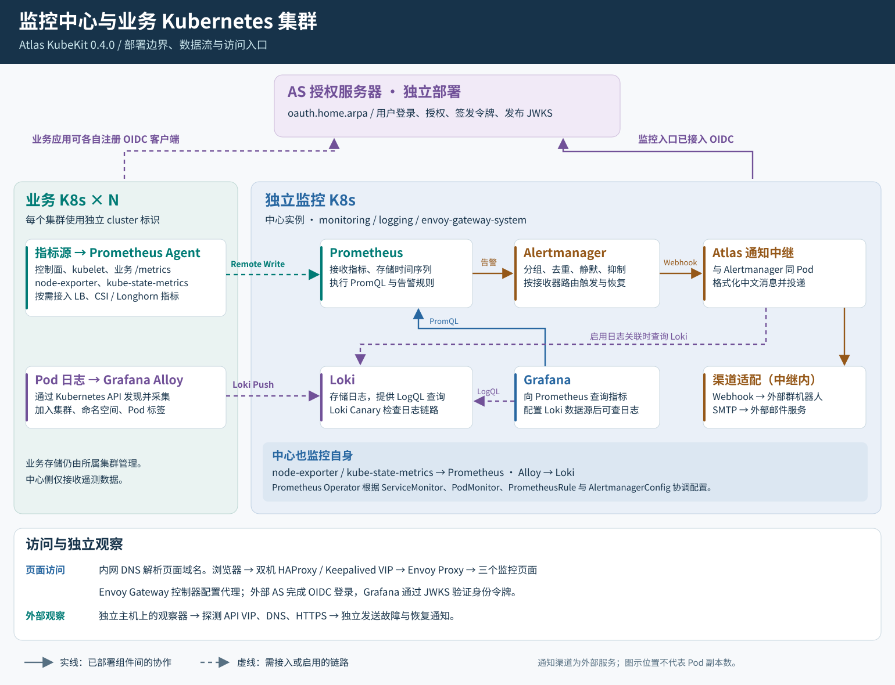

# 07.05 监控中心与业务集群架构图

[打开矢量原图，可放大查看](图/监控中心与业务集群.svg)

## 三套系统的部署边界

| 系统 | 部署内容 | 与其他系统的约定 |
| --- | --- | --- |
| 独立授权服务器（AS） | 运行自己的用户登录、授权、令牌签发和签名公钥发布服务 | 监控入口已接入。业务应用也可单独注册客户端，配置自己的回调地址、权限范围及令牌受众。使用同一个 AS 不会自动授予访问其他应用的权限。 |
| 独立监控 Kubernetes 集群 | 集中运行指标库、日志库、规则评估、告警路由、通知中继、看板与入口代理，同时部署自身的采集端 | 面向运维人员提供三个 HTTPS 页面，面向采集端提供独立写入接口。 |
| 业务 Kubernetes 集群 × N | 运行应用、业务存储以及本集群的轻量采集端 | 每个集群使用唯一的 `cluster` 标签向中心推送，便于区分不同集群中同名的命名空间、Pod 和服务。 |

图中业务集群的指标与日志上送是脚本支持的拓扑。三个监控页面已由用户确认可访问；判断某个业务集群是否接入，要分别在中心查询该集群的指标和日志。

## 中心组件如何协作

| 组件 | 输入 → 输出 |
| --- | --- |
| Prometheus Operator | 读取 ServiceMonitor、PodMonitor、PrometheusRule 和 AlertmanagerConfig 等 Kubernetes 资源，生成采集、规则和路由配置。Prometheus 与 Alertmanager Pod 中的 config-reloader 负责触发配置重载。 |
| node-exporter、kube-state-metrics | 前者提供节点 CPU、内存、磁盘等指标，后者把 Kubernetes API 中的工作负载与节点对象状态转为指标。Prometheus 在中心抓取它们，业务集群由本地 Agent 抓取。 |
| Prometheus | 抓取中心自身指标，接收业务 Agent 的 Remote Write，保存时间序列，响应 Grafana 的 PromQL 查询。规则满足触发条件后将告警发给 Alertmanager，条件解除后更新状态。 |
| Grafana Alloy、Loki、Loki Canary | Alloy 通过 Kubernetes API 采集所选命名空间的 Pod 日志并写入 Loki。Loki 提供 LogQL 查询。Canary 写入带标识的测试日志并检查能否读回。 |
| Alertmanager | 接收 Prometheus 告警，执行分组、去重、静默、抑制与路由。机器人及增强通知走中继，也可以单独配置原生 SMTP 接收器。 |
| Atlas 通知中继 | 作为 Alertmanager Pod 的边车接收 Webhook。启用日志关联时按告警对象及时间窗口查询 Loki，生成中文触发或恢复消息，投递到配置的企微、钉钉、飞书或邮件接收端。 |
| Grafana | 从 Prometheus 查询并展示指标，通过 Alertmanager 数据源查看告警。配置 Loki 数据源后可在 Explore 查询日志。看板和数据源边车监听相应 ConfigMap，向 Grafana 装载配置。 |
| Envoy Gateway、Envoy Proxy | 控制器根据 Gateway、HTTPRoute 和认证策略配置代理。实际浏览器 HTTPS 流量由 Envoy Proxy 接收，按域名送到相应服务。 |

## 两条访问路径

**人访问监控。** 内网 DNS 把三个监控域名解析到入口 VIP。浏览器连接双机 HAProxy / Keepalived 提供的入口，经 Envoy Proxy 进入 Grafana、Prometheus 或 Alertmanager。需要认证时，浏览器跳转到独立 AS，授权后回到原页面域名。Grafana 通过已配置的令牌校验建立用户身份。业务应用如需单点登录，可直接信任该 AS，无需经过监控入口。

**机器上送数据。** 业务集群的 Prometheus Agent 发现并抓取 kubelet、控制面、exporter 和应用端点，通过 HTTPS 向中心的 `/api/v1/write` 写入指标。业务 Alloy 将选定 Pod 日志推送到 Loki 的 `/loki/api/v1/push`。两条写入路径都需要可达的接收端、受信任的证书及配置的机器凭据。页面登录成功只验证浏览器路径。

## 集群之外还运行什么

- **DNS 与双机负载均衡**提供域名解析和入口 VIP。Envoy Gateway 控制器及其数据面运行在监控集群内。
- **独立观察器**可部署在一台能从集群外访问目标的主机上，独立探测 API VIP、DNS 或 HTTPS 并投递通知。监控集群整体失联时，中心自身的告警路由也会受影响，外部观察器仍有机会报告故障。
- **业务侧专项指标**由实际拥有资源的一侧提供，例如从 LB 主机采集 HAProxy/VIP 指标，从部署了 Longhorn 的集群采集卷和副本状态。卷的数据始终由业务存储管理。
- **外部通知平台**接收中继或邮件接收器的投递。图中的渠道适配逻辑随监控中心运行，机器人平台和 SMTP 服务器独立运行。

各组件的页面、看板和访问范围见[运维门户页面与组件入口清单](06-运维门户页面与组件入口清单.md)。
