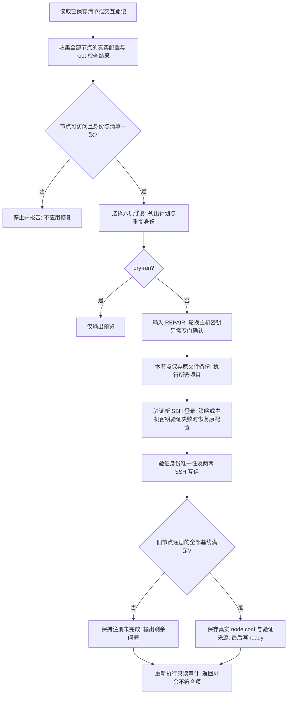

# 旧集群基线修复：设计与验证边界

`02-deploy-cluster.sh --repair` 面向已运行集群的主机基线补齐。与完整部署入口分开；不调用安装阶段，不升级包、不更改网络或机器 ID、不移动组件数据、不执行 kubeadm。

## 工作流程

## 风险与验收项目

| 风险 | 实现约束 | 需要的功能验证 |
| --- | --- | --- |
| 预览意外写配置 | dry-run 禁止配对，不创建保存清单，只收集和展示 | 对比预览前后的 hosts/SSH/sudo/节点状态 |
| 非交互批量误操作 | 实际修复必须使用终端，输入 REPAIR | EOF/取消时不应用基线修复 |
| 旧集群身份误改 | 核对注册 hostname/IP，保留 machine-id、UUID、MAC | 清单错配时修复前停止 |
| 管理员被锁出 | 保留 authorized_keys；SSH 策略前后验证新连接 | Match/优先配置冲突、新连接失败及回退 |
| 主机指纹变化后连接中断 | 额外确认、保留 SSH master、备份所有主机密钥、更新集群公钥固定记录 | 新连接失败后恢复原密钥；核对外部客户端更新指引 |
| 发起节点自己的私钥被替换 | 本机 root 临时目录保存原传输密钥；不发送到其他节点 | 重复节点密钥包含发起节点时仍能推进并清理临时凭据 |
| 私钥泄露 | 私钥留在所属节点，备份 root-only；输出公钥指纹，密码只在内存和 stdin 中传递 | 检查输出、文件权限、进程参数 |
| ready 掩盖未完成配置 | 每节点验证基线和互信，集群身份重复时阻止注册 | 未修复重复主机密钥时不新增 ready |
| 有效旧配置被覆盖 | 已验证的节点密钥及已登记配置保留；磁盘只读检查 | 重跑不更换正确密钥，不改已有存储布局 |
| 部分修复失败 | 已完成项和 root 备份保留，失败项停止并给出重跑路径 | 首次失败后的再次执行与剩余项报告 |

## 证据记录规则

语法检查、真实环境只读预览、实际修复、故障注入与回退分别记录。仅有语法检查或预览，不代表实际修复和回退已验证。实际修复需在明确选定的环境确认执行；外部 Mac/DBX 的主机指纹不会由集群节点自动修改。

验证来源记录为 `adopted-baseline.json`。它说明旧节点当前主机基线已验证并登记，不表示该节点实际执行了新装流程中的系统升级或重启，也不代替 Kubernetes 业务功能、HA 切换、备份恢复验收。

## 当前实现证据：2026-10-02

- Bash 与 Python 语法解析、版本生成区块一致性、存储嵌入一致性和 Git diff 空白检查通过。
- 完整工程同步到旧集群 8 台节点，02 与两个修复辅助脚本的 SHA-256 一致。
- 从旧集群 lb1 运行 `02 --repair --sudo --items all --dry-run`，成功读取 8 台节点，列出缺失基线和重复主机密钥，退出码为 0；本次未选择应用修复。
- **尚未执行**实际六项修复、负面授权、故障注入、自动回退和修复重跑验收。上述风险表是待执行的功能验证清单，不应据预览宣称修复 E2E 已通过。
